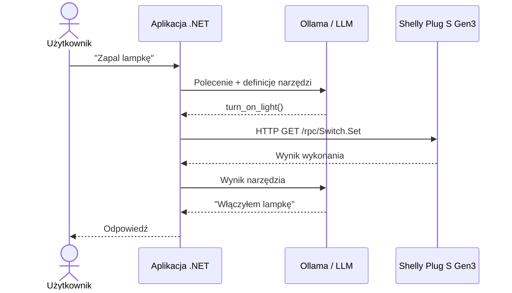

# Shelly.ToolCalling

Sterowanie inteligentnym gniazdkiem Shelly Plug S Gen3 za pomocą języka naturalnego, z wykorzystaniem **LLM i Tool Calling**.

## Cel

Demonstracja mechanizmu *Tool Calling*, w którym model językowy wybiera odpowiednią funkcję na podstawie polecenia użytkownika.

W przeciwieństwie do projektu `Shelly.Http`, aplikacja nie decyduje samodzielnie, kiedy włączyć lub wyłączyć lampkę.

Decyzję o wyborze narzędzia podejmuje model językowy, natomiast wykonanie funkcji pozostaje po stronie aplikacji .NET.

## Wymagania

* .NET SDK
* Ollama
* Model qwen3:4b
* Shelly Plug S Gen3
* Komputer i Shelly podłączone do tej samej sieci Wi-Fi

## Instalacja

1. Pobierz model językowy:

   ```bash
   ollama pull qwen3:4b
   ```

2. Uruchom Ollama:

   ```bash
   ollama serve
   ```

Upewnij się, że serwer Ollama jest uruchomiony i dostępny pod adresem `http://localhost:11434`.

## Uruchomienie

Z katalogu Shelly:

```bash
dotnet run --project 02-Shelly.ToolCalling -- http://172.20.10.2
```

Adres IP należy zastąpić rzeczywistym adresem urządzenia Shelly.


Możesz również użyć nazwy mDNS urządzenia, jeśli ją znasz. Dzięki temu nie musisz martwić się o zmieniający się adres IP.
```
dotnet run --project 02-Shelly.ToolCalling -- http://shellyplugsg3-e4b063fe411c.local
```

Rozpoznawanie nazw mDNS wymaga obsługi tego protokołu w sieci i systemie operacyjnym. macOS obsługuje mDNS za pośrednictwem usługi Bonjour, natomiast Windows 10 i 11 oferują obsługę mDNS, której działanie może zależeć od konfiguracji systemu.

## Przykładowa interakcja

```
Connecting to Shelly at http://172.20.10.2
Enter a command (or 'exit' to quit):
> Zapal lampkę
[Tool] Turning light on...
Assistant: Włączyłem lampkę.
> Zgaś światło
[Tool] Turning light off...
Assistant: Wyłączyłem lampkę.
> exit
```

## Jak to działa?

Przepływ sterowania:

```
Użytkownik
    |
    | "Zapal lampkę"
    v
   LLM
    |
    | turn_on_light()
    v
Aplikacja .NET
    |
    | HTTP RPC
    v
Shelly Plug S Gen3
    |
    v
Lampka włączona
```

Diagram sekwencji:



Aplikacja udostępnia modelowi dwa narzędzia:

| Narzędzie        | Działanie      |
|------------------|----------------|
| `turn_on_light`  | Włącza lampkę  |
| `turn_off_light` | Wyłącza lampkę |

Narzędzia są rejestrowane za pomocą `AIFunctionFactory.Create()`.

Biblioteka `Microsoft.Extensions.AI` obsługuje ich automatyczne wywoływanie dzięki `UseFunctionInvocation()`.

## Ważne rozróżnienie

**Model językowy nie wykonuje kodu C# ani nie wysyła żądań HTTP do Shelly.**

Model wybiera narzędzie, a aplikacja:

1. Odbiera żądanie wywołania narzędzia.
2. Uruchamia odpowiednią funkcję C#.
3. Wysyła żądanie HTTP do Shelly.
4. Przekazuje wynik wykonania do modelu.
5. Wyświetla odpowiedź użytkownikowi.

## Eksperymenty

Spróbuj wydać następujące polecenia:

* „Zapal lampkę”.
* „Wyłącz światło”.
* „Zrób jasno”.
* „Nie chcę już światła”.
* „Jaka jest stolica Francji?”.

Zwróć uwagę, kiedy model wybiera narzędzie, a kiedy odpowiada bez jego użycia.

## Co dalej?

W kolejnym projekcie, `Shelly.Mcp`, udostępnimy te same operacje za pomocą **Model Context Protocol (MCP)**.

Dzięki temu narzędzia sterujące Shelly będą mogły być wykorzystywane przez różne aplikacje i agentów obsługujących MCP, bez konieczności implementowania ich osobno w każdym kliencie.