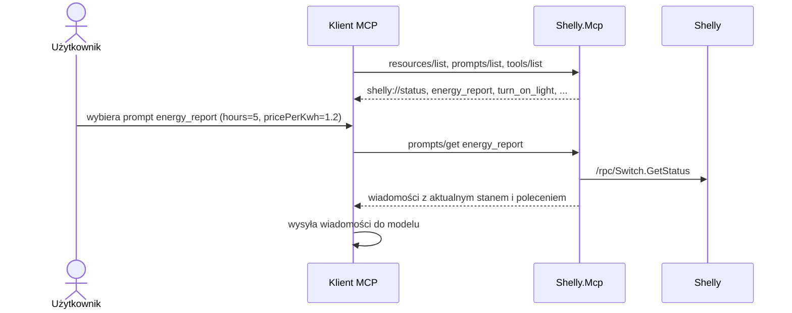
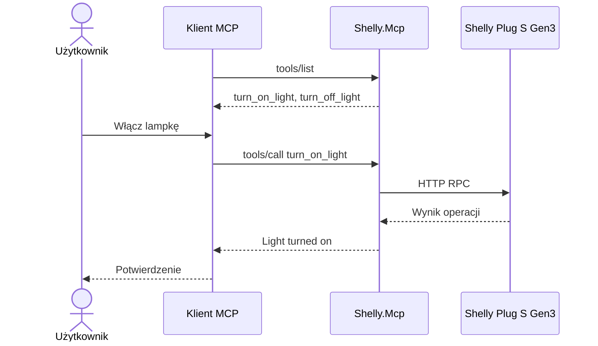

# Shelly.Mcp

Sterowanie inteligentnym gniazdkiem Shelly Plug S Gen3 za pomocą **Model Context Protocol (MCP)**.

## Cel

Demonstracja udostępniania narzędzi, zasobów i szablonów poleceń przez niezależny serwer MCP.

W poprzednim projekcie `Shelly.ToolCalling` funkcje sterujące lampką były zdefiniowane bezpośrednio w aplikacji korzystającej z modelu językowego.

W tym przykładzie wydzielamy je do osobnego serwera MCP, dzięki czemu mogą być wykorzystywane przez różne aplikacje i agentów obsługujących ten protokół.

**MCP nie zastępuje Tool Calling — standaryzuje sposób udostępniania i wywoływania narzędzi.**

Narzędzia to jednak tylko jeden z trzech elementów, które może udostępniać serwer MCP. `Shelly.Mcp` udostępnia wszystkie trzy:

| Element MCP | Co udostępnia `Shelly.Mcp` |
|---|---|
| **Tools** (narzędzia) | `turn_on_light`, `turn_off_light` |
| **Resources** (zasoby) | `shelly://status`, `shelly://config` |
| **Prompts** (szablony poleceń) | `ensure_light_state`, `energy_report` |

## Wymagania

* .NET SDK
* Shelly Plug S Gen3
* Komputer i Shelly podłączone do tej samej sieci Wi-Fi
* Node.js i npm (do uruchomienia MCP Inspector)

Serwer MCP nie wymaga modelu językowego ani Ollama.

## Uruchomienie

Z katalogu Shelly:

```bash
dotnet run --project 03-Shelly.Mcp -- http://172.20.10.2
```

Adres IP należy zastąpić rzeczywistym adresem urządzenia Shelly.

Serwer wykorzystuje transport *stdio*, czyli komunikuje się z klientem MCP przez standardowe wejście i wyjście procesu.

Po uruchomieniu aplikacja działa jako **serwer MCP (Model Context Protocol)**, udostępniający narzędzia `turn_on_light` i `turn_off_light`, zasoby `shelly://status` i `shelly://config` oraz prompty `ensure_light_state` i `energy_report`.

Serwer nie wyświetla interaktywnego menu ani nie przyjmuje poleceń użytkownika bezpośrednio z konsoli. Wykorzystuje transport **stdio** i oczekuje na komunikaty od **klienta MCP**, np. MCP Inspector lub Claude Desktop.

Aby wywołać udostępnione narzędzia, należy połączyć się z serwerem za pomocą klienta MCP.


## Testowanie — MCP Inspector

Najprościej przetestować serwer za pomocą MCP Inspector.

Z katalogu Shelly:

```bash
npx @modelcontextprotocol/inspector \
  dotnet run --project 03-Shelly.Mcp -- http://172.20.10.2
```

Inspector uruchomi interfejs dostępny w przeglądarce.

Wybierz transport **STDIO**, a następnie:

1. Kliknij **Connect**.
2. Otwórz zakładkę **Tools**.
3. Kliknij **List Tools**.
4. Wybierz `turn_on_light` lub `turn_off_light`.
5. Kliknij **Run Tool**.

Lampka powinna odpowiednio się włączyć lub wyłączyć.

Zasoby i prompty sprawdzisz w zakładkach **Resources** i **Prompts**:

1. **Resources** → **List Resources** → `status` — wyświetla aktualny stan lampki w formacie JSON.
2. **Prompts** → **List Prompts** → `energy_report` — podaj `hours` i `pricePerKwh`, a następnie kliknij **Get Prompt**, aby zobaczyć wygenerowane wiadomości.

### Testowanie z wiersza poleceń

MCP Inspector ma również tryb CLI, przydatny do szybkiego sprawdzenia serwera bez przeglądarki:

```bash
npx @modelcontextprotocol/inspector --cli \
  dotnet run --project 03-Shelly.Mcp -- http://localhost:8080 \
  --method resources/read --uri shelly://status
```

```bash
npx @modelcontextprotocol/inspector --cli \
  dotnet run --project 03-Shelly.Mcp -- http://localhost:8080 \
  --method prompts/get --prompt-name energy_report --prompt-args hours=5 pricePerKwh=1.2
```

Inne metody: `tools/list`, `resources/list`, `prompts/list`.

## Dostępne narzędzia

| Narzędzie      | Opis           |
|----------------|----------------|
| `turn_on_light`  | Włącza lampkę  |
| `turn_off_light` | Wyłącza lampkę |

Nazwy narzędzi są tworzone z nazw metod C# (`TurnOnLight` → `turn_on_light`).

Narzędzia są udostępniane przez serwer MCP za pomocą atrybutów:

```csharp
[McpServerToolType]
public static class ShellyTools
{
    [McpServerTool]
    [Description("Turns on the light")]
    public static async Task<string> TurnOnLight(HttpClient http)
    {
        var response = await http.GetAsync("/rpc/Switch.Set?id=0&on=true");
        response.EnsureSuccessStatusCode();
        return "Light turned on.";
    }
}
```

## Dostępne zasoby (resources)

| Zasób | Typ | Opis |
|---|---|---|
| `shelly://status` | `application/json` | Aktualny stan lampki: włączona/wyłączona, moc, napięcie, prąd, energia, temperatura. |
| `shelly://config` | `application/json` | Konfiguracja lampki, w tym jej nazwa. |

**Zasób to dane, a nie działanie.** Odczyt zasobu nie zmienia stanu urządzenia. Klient MCP może dołączyć jego treść do kontekstu modelu, zanim model zacznie odpowiadać.

```csharp
[McpServerResourceType]
public static class ShellyResources
{
    [McpServerResource(UriTemplate = "shelly://status", Name = "status", MimeType = "application/json")]
    [Description("Current Shelly light status: on/off state, power in watts, voltage, current, energy and temperature.")]
    public static async Task<string> Status(HttpClient http)
    {
        return await http.GetStringAsync("/rpc/Switch.GetStatus?id=0");
    }
}
```

Zasób jest identyfikowany przez **URI**. Schemat `shelly://` jest umowny — serwer może używać dowolnych schematów, np. `file://`, `db://` czy własnych. URI może też zawierać parametry (np. `shelly://switch/{id}/status`) — wtedy jest to **szablon zasobu** (*resource template*).

## Dostępne prompty (prompts)

| Prompt | Argumenty | Opis |
|---|---|---|
| `ensure_light_state` | `state` (`on` / `off`) | Polecenie doprowadzenia lampki do żądanego stanu, z dołączonym aktualnym stanem urządzenia. |
| `energy_report` | `hours`, `pricePerKwh` | Polecenie przygotowania raportu zużycia i kosztu energii na podstawie aktualnej mocy lampki. |

**Prompt to gotowy szablon polecenia przygotowany przez autora serwera.** Użytkownik wybiera go w kliencie MCP (np. jako polecenie `/`), podaje argumenty, a serwer zwraca wiadomości, które trafiają do modelu.

```csharp
[McpServerPromptType]
public static class ShellyPrompts
{
    [McpServerPrompt(Name = "energy_report")]
    [Description("Prepares an energy usage and cost report for the light based on its current power.")]
    public static async Task<IEnumerable<ChatMessage>> EnergyReport(
        HttpClient http,
        [Description("Number of hours the light is on")] double hours,
        [Description("Energy price per kWh, e.g. 1.20")] double pricePerKwh)
    {
        var status = await http.GetStringAsync("/rpc/Switch.GetStatus?id=0");

        return
        [
            new ChatMessage(ChatRole.User, $"Aktualny stan lampki Shelly (JSON): {status} ..."),
            new ChatMessage(ChatRole.User, $"Przygotuj krótki raport zużycia energii ... {hours} ... {pricePerKwh} ...")
        ];
    }
}
```

Prompt może zwrócić tekst (`string`) albo listę wiadomości (`ChatMessage`). Może też — jak w tym przykładzie — od razu pobrać aktualne dane z urządzenia i dołączyć je do treści. Wiedza o tym, jak dobrze zapytać model o raport energii, jest zapisana w serwerze, a nie w każdym kliencie osobno.

## Tools, resources, prompts — kto decyduje?

Trzy elementy MCP różnią się przede wszystkim tym, **kto decyduje o ich użyciu**:

| Element | Kto decyduje | Przykład w `Shelly.Mcp` | Analogia |
|---|---|---|---|
| **Tools** | **Model** — sam wybiera narzędzie podczas rozmowy | Model wywołuje `turn_on_light` | Funkcja (`POST`) |
| **Resources** | **Aplikacja** (klient MCP) — decyduje, jakie dane dołączyć do kontekstu | Klient dołącza `shelly://status` | Plik lub endpoint `GET` |
| **Prompts** | **Użytkownik** — świadomie wybiera szablon | Użytkownik wybiera `energy_report` | Polecenie `/` w menu |



Dlatego `ensure_light_state` nie każe modelowi „odczytać zasobu `shelly://status`” — zasoby udostępnia klient, a nie model, i wiele klientów nie daje modelowi takiej możliwości. Zamiast tego prompt sam dołącza aktualny stan lampki do treści.

### Rejestracja

```csharp
builder.Services
    .AddMcpServer()
    .WithStdioServerTransport()
    .WithToolsFromAssembly()
    .WithResourcesFromAssembly()
    .WithPromptsFromAssembly();
```

## Jak to działa?



W tym przykładzie klientem jest MCP Inspector, który pozwala ręcznie wywoływać narzędzia.

W przypadku klienta wykorzystującego LLM wybór narzędzia może zostać dokonany przez model językowy.

## Najważniejsze elementy

### Rejestracja serwera MCP

```csharp
builder.Services
    .AddMcpServer()
    .WithStdioServerTransport()
    .WithToolsFromAssembly()
    .WithResourcesFromAssembly()
    .WithPromptsFromAssembly();
```

* `AddMcpServer()` — rejestruje serwer MCP.
* `WithStdioServerTransport()` — konfiguruje komunikację przez stdin/stdout.
* `WithToolsFromAssembly()` — automatycznie odkrywa narzędzia oznaczone atrybutem `[McpServerTool]`.
* `WithResourcesFromAssembly()` — odkrywa zasoby oznaczone atrybutem `[McpServerResource]`.
* `WithPromptsFromAssembly()` — odkrywa prompty oznaczone atrybutem `[McpServerPrompt]`.

### Definiowanie narzędzi

Atrybut `[McpServerTool]` udostępnia metodę jako narzędzie MCP.

Atrybut `[Description]` opisuje działanie narzędzia klientom MCP i modelom językowym.

### Wykonywanie operacji

Serwer MCP wykonuje żądania HTTP do lokalnego API Shelly.

**Model językowy nie jest potrzebny do wykonania operacji — wystarczy klient MCP.**

## Porównanie projektów

|                                | Shelly.Http | Shelly.ToolCalling | Shelly.Mcp                     |
|--------------------------------|-------------|--------------------|--------------------------------|
| Sterowanie HTTP                | Tak         | Tak                | Tak                            |
| Model językowy                 | Nie         | Tak                | Nie jest wymagany              |
| Tool Calling                   | Nie         | Tak                | Może być używany przez klienta |
| Serwer MCP                     | Nie         | Nie                | Tak                            |
| Ponowne wykorzystanie narzędzi | Kod aplikacji | Integracja z LLM | Standardowy protokół MCP       |

## Eksperymenty

1. Uruchom serwer MCP i połącz się przez MCP Inspector.
2. Wyświetl listę dostępnych narzędzi.
3. Włącz i wyłącz lampkę.
4. Odczytaj zasób `shelly://status` przed włączeniem lampki i po nim. Porównaj pole `apower`.
5. Pobierz prompt `energy_report` dla lampki włączonej i wyłączonej. Zwróć uwagę, że treść promptu zmienia się razem ze stanem urządzenia.
6. Zatrzymaj serwer i sprawdź zachowanie klienta.
7. Zastanów się, jak udostępnić te same narzędzia innemu klientowi MCP.

## Połączenie z Claude Code CLI

Serwer `Shelly.Mcp` można podłączyć do **Claude Code** jako lokalny serwer MCP wykorzystujący transport `stdio`.

Claude automatycznie uruchamia serwer MCP jako proces potomny, dlatego nie trzeba uruchamiać go wcześniej w osobnym terminalu.

### 1. Zbudowanie serwera

Z katalogu `Shelly`:

```bash
dotnet build 03-Shelly.Mcp -c Release
```

### 2. Rejestracja serwera w Claude Code

```bash
claude mcp add --transport stdio shelly -- \
  dotnet /Users/username/Projects/Shelly/03-Shelly.Mcp/bin/Release/net10.0/Shelly.Mcp.dll \
  http://172.20.10.2
```

Należy zastąpić:
- Ścieżkę do `Shelly.Mcp.dll` rzeczywistą ścieżką na komputerze.
- `172.20.10.2` rzeczywistym adresem IP urządzenia Shelly.

Pełną ścieżkę do DLL można sprawdzić poleceniem:

```bash
realpath 03-Shelly.Mcp/bin/Release/*/Shelly.Mcp.dll
```

Domyślnie Claude zapisuje konfigurację serwera MCP lokalnie dla bieżącego projektu.

Aby serwer był dostępny we wszystkich projektach, można użyć `--scope user`.

### 3. Sprawdzenie połączenia

```bash
claude mcp list
claude mcp get shelly
```

Następnie uruchom Claude Code:

```bash
claude
```

Wpisz `/mcp`, aby sprawdzić stan połączenia z serwerem.

### 4. Sterowanie lampką

W rozmowie z Claude wpisz:

> Zapal lampkę.

Claude powinien wybrać narzędzie `turn_on_light`, wywołać je przez MCP i potwierdzić wykonanie operacji.

Analogicznie:

> Zgaś lampkę.

Claude wywoła narzędzie `turn_off_light`.

### 5. Zasoby i prompty w Claude Code

Zasób dołączysz do rozmowy, wpisując `@` i wybierając go z listy:

> @shelly:shelly://status Czy lampka jest teraz włączona?

Prompty serwera są dostępne jako polecenia `/`:

```text
/mcp__shelly__energy_report 5 1.2
/mcp__shelly__ensure_light_state off
```

W pierwszym przypadku to Ty decydujesz, jakie dane trafią do kontekstu. W drugim wybierasz gotowy szablon przygotowany przez autora serwera. W obu przypadkach o wywołaniu narzędzi nadal decyduje model.

**W tym przykładzie Claude jest klientem MCP, a aplikacja .NET działa jako serwer MCP.**

Nie jest potrzebny Ollama ani własna implementacja klienta MCP.

## Co dalej?

Kolejnym krokiem może być podłączenie serwera `Shelly.Mcp` do aplikacji wykorzystującej model językowy.

Wówczas model będzie mógł odkrywać i wybierać narzędzia udostępniane przez serwer MCP.

W ten sposób przechodzimy od:

```
HTTP → Tool Calling → MCP
```

Ta sama lampka, te same operacje, ale inny sposób udostępniania funkcjonalności.
