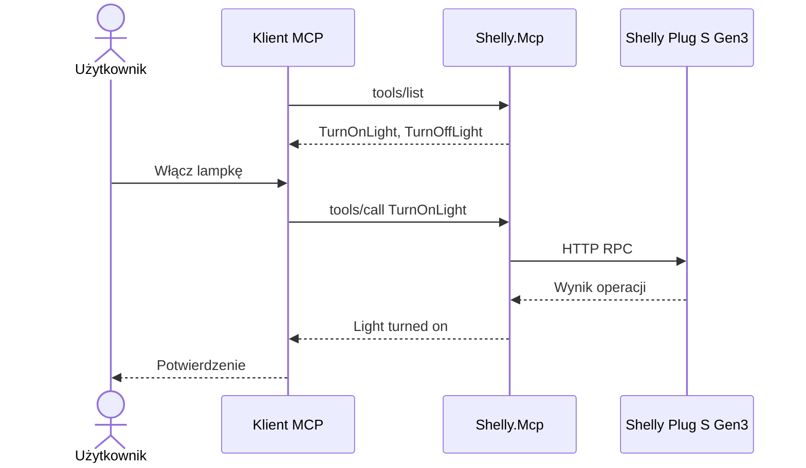

# Shelly.Mcp

Sterowanie inteligentnym gniazdkiem Shelly Plug S Gen3 za pomocą **Model Context Protocol (MCP)**.

## Cel

Demonstracja udostępniania narzędzi przez niezależny serwer MCP.

W poprzednim projekcie `Shelly.ToolCalling` funkcje sterujące lampką były zdefiniowane bezpośrednio w aplikacji korzystającej z modelu językowego.

W tym przykładzie wydzielamy je do osobnego serwera MCP, dzięki czemu mogą być wykorzystywane przez różne aplikacje i agentów obsługujących ten protokół.

**MCP nie zastępuje Tool Calling — standaryzuje sposób udostępniania i wywoływania narzędzi.**

## Wymagania

* .NET SDK
* Shelly Plug S Gen3
* Komputer i Shelly podłączone do tej samej sieci Wi-Fi
* Node.js i npm (do uruchomienia MCP Inspector)

Serwer MCP nie wymaga modelu językowego ani Ollama.

## Uruchomienie

Z katalogu Shelly:

```bash
dotnet run --project 03-Shelly.Mcp -- http://172.20.10.2
```

Adres IP należy zastąpić rzeczywistym adresem urządzenia Shelly.

Serwer wykorzystuje transport *stdio*, czyli komunikuje się z klientem MCP przez standardowe wejście i wyjście procesu.

Po uruchomieniu aplikacja działa jako **serwer MCP (Model Context Protocol)**, udostępniający narzędzia `TurnOnLight` i `TurnOffLight`.

Serwer nie wyświetla interaktywnego menu ani nie przyjmuje poleceń użytkownika bezpośrednio z konsoli. Wykorzystuje transport **stdio** i oczekuje na komunikaty od **klienta MCP**, np. MCP Inspector lub Claude Desktop.

Aby wywołać udostępnione narzędzia, należy połączyć się z serwerem za pomocą klienta MCP.


## Testowanie — MCP Inspector

Najprościej przetestować serwer za pomocą MCP Inspector.

Z katalogu Shelly:

```bash
npx @modelcontextprotocol/inspector \
  dotnet run --project 03-Shelly.Mcp -- http://172.20.10.2
```

Inspector uruchomi interfejs dostępny w przeglądarce.

Wybierz transport **STDIO**, a następnie:

1. Kliknij **Connect**.
2. Otwórz zakładkę **Tools**.
3. Kliknij **List Tools**.
4. Wybierz `TurnOnLight` lub `TurnOffLight`.
5. Kliknij **Run Tool**.

Lampka powinna odpowiednio się włączyć lub wyłączyć.

## Dostępne narzędzia

| Narzędzie      | Opis           |
|----------------|----------------|
| `TurnOnLight`  | Włącza lampkę  |
| `TurnOffLight` | Wyłącza lampkę |

Narzędzia są udostępniane przez serwer MCP za pomocą atrybutów:

```csharp
[McpServerToolType]
public static class ShellyTools
{
    [McpServerTool]
    [Description("Turns on the light")]
    public static async Task<string> TurnOnLight(HttpClient http)
    {
        var response = await http.GetAsync("/rpc/Switch.Set?id=0&on=true");
        response.EnsureSuccessStatusCode();
        return "Light turned on.";
    }
}
```

## Jak to działa?



W tym przykładzie klientem jest MCP Inspector, który pozwala ręcznie wywoływać narzędzia.

W przypadku klienta wykorzystującego LLM wybór narzędzia może zostać dokonany przez model językowy.

## Najważniejsze elementy

### Rejestracja serwera MCP

```csharp
builder.Services
    .AddMcpServer()
    .WithStdioServerTransport()
    .WithToolsFromAssembly();
```

* `AddMcpServer()` — rejestruje serwer MCP.
* `WithStdioServerTransport()` — konfiguruje komunikację przez stdin/stdout.
* `WithToolsFromAssembly()` — automatycznie odkrywa narzędzia oznaczone atrybutami MCP.

### Definiowanie narzędzi

Atrybut `[McpServerTool]` udostępnia metodę jako narzędzie MCP.

Atrybut `[Description]` opisuje działanie narzędzia klientom MCP i modelom językowym.

### Wykonywanie operacji

Serwer MCP wykonuje żądania HTTP do lokalnego API Shelly.

**Model językowy nie jest potrzebny do wykonania operacji — wystarczy klient MCP.**

## Porównanie projektów

|                                | Shelly.Http | Shelly.ToolCalling | Shelly.Mcp                     |
|--------------------------------|-------------|--------------------|--------------------------------|
| Sterowanie HTTP                | Tak         | Tak                | Tak                            |
| Model językowy                 | Nie         | Tak                | Nie jest wymagany              |
| Tool Calling                   | Nie         | Tak                | Może być używany przez klienta |
| Serwer MCP                     | Nie         | Nie                | Tak                            |
| Ponowne wykorzystanie narzędzi | Kod aplikacji | Integracja z LLM | Standardowy protokół MCP       |

## Eksperymenty

1. Uruchom serwer MCP i połącz się przez MCP Inspector.
2. Wyświetl listę dostępnych narzędzi.
3. Włącz i wyłącz lampkę.
4. Zatrzymaj serwer i sprawdź zachowanie klienta.
5. Zastanów się, jak udostępnić te same narzędzia innemu klientowi MCP.

## Co dalej?

Kolejnym krokiem może być podłączenie serwera `Shelly.Mcp` do aplikacji wykorzystującej model językowy.

Wówczas model będzie mógł odkrywać i wybierać narzędzia udostępniane przez serwer MCP.

W ten sposób przechodzimy od:

```
HTTP → Tool Calling → MCP
```

Ta sama lampka, te same operacje, ale inny sposób udostępniania funkcjonalności.
