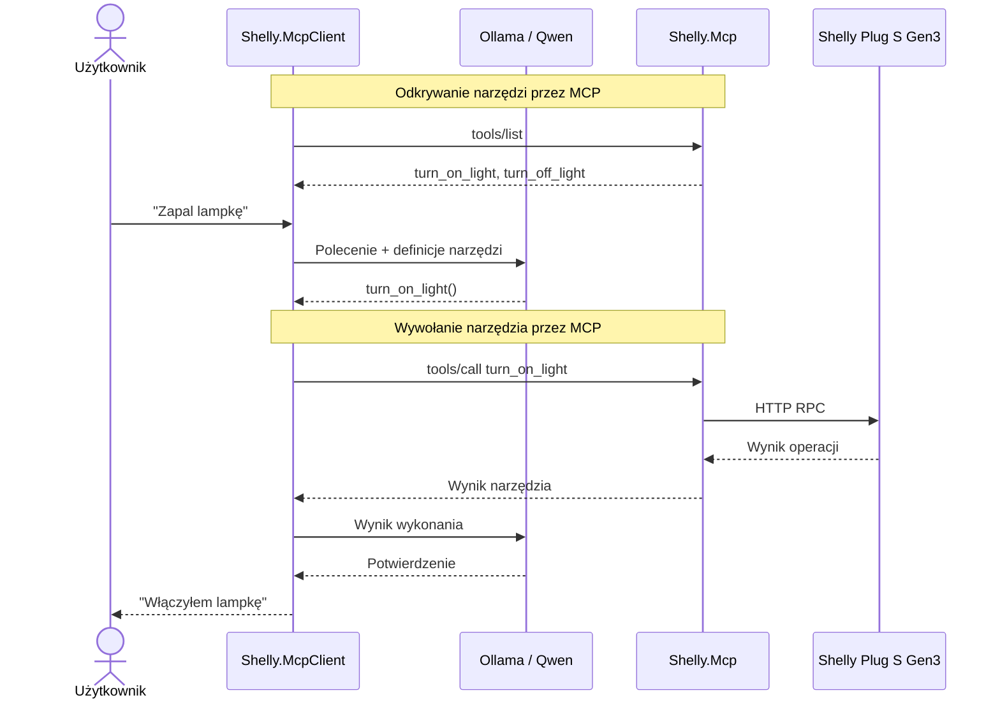

# Shelly.McpClient

Sterowanie inteligentnym gniazdkiem Shelly Plug S Gen3 za pomocą modelu językowego (LLM), **Tool Calling** oraz **Model Context Protocol (MCP)**.

## Cel

Demonstracja wykorzystania narzędzi udostępnianych przez niezależny serwer MCP w aplikacji .NET korzystającej z modelu językowego.

W poprzednich projektach:

* `01-Shelly.Http` — sterowaliśmy urządzeniem bezpośrednio przez HTTP.
* `02-Shelly.ToolCalling` — model językowy wybierał funkcje C# zdefiniowane w aplikacji.
* `03-Shelly.Mcp` — udostępniliśmy te funkcje przez niezależny serwer MCP.

W tym przykładzie łączymy Tool Calling z MCP.

Aplikacja korzysta z modelu Qwen uruchomionego lokalnie przez Ollama, ale zamiast definiować własne funkcje sterujące lampką, odkrywa narzędzia udostępniane przez serwer `Shelly.Mcp`.

**MCP nie zastępuje Tool Calling — pozwala oddzielić narzędzia od aplikacji wykorzystującej model językowy.**

## Wymagania

* .NET SDK
* Ollama
* Model `qwen2.5:3b`
* Shelly Plug S Gen3
* Komputer i Shelly podłączone do tej samej sieci Wi-Fi
* Projekt `03-Shelly.Mcp`

Model językowy działa lokalnie. Nie jest wymagany klucz API do zewnętrznego dostawcy LLM.

## Instalacja

Z katalogu Shelly:

```bash
dotnet add 04-Shelly.McpClient package ModelContextProtocol
dotnet add 04-Shelly.McpClient package Microsoft.Extensions.AI
dotnet add 04-Shelly.McpClient package OllamaSharp
```

Pobierz model:

```bash
ollama pull qwen2.5:3b
```

Upewnij się, że serwer Ollama jest uruchomiony i dostępny pod adresem `http://localhost:11434`.

## Uruchomienie

Z katalogu Shelly:

```bash
dotnet run --project 04-Shelly.McpClient -- http://172.20.10.2
```

Adres IP należy zastąpić rzeczywistym adresem urządzenia Shelly.

Aplikacja automatycznie uruchamia serwer `03-Shelly.Mcp` jako proces potomny i komunikuje się z nim przez transport *stdio*.

### Wybór modelu i zdalne API

Domyślnie używany jest lokalny model `qwen2.5:3b` z Ollamy. Inny model wskażesz parametrem `--model`.

Zamiast Ollamy możesz użyć dowolnego API zgodnego z OpenAI Chat Completions (np. `https://llm.hpc.psnc.pl/v1`). Adres podaj parametrem `--endpoint`, a klucz API w zmiennej środowiskowej `LLM_API_KEY`:

```bash
export LLM_API_KEY=<YOUR_API_KEY>
dotnet run --project 04-Shelly.McpClient -- http://172.20.10.2 --endpoint https://llm.hpc.psnc.pl/v1 --model DeepSeek-V3.1
```

PowerShell:

```powershell
$env:LLM_API_KEY="<YOUR_API_KEY>"
dotnet run --project 04-Shelly.McpClient -- http://172.20.10.2 --endpoint https://llm.hpc.psnc.pl/v1 --model DeepSeek-V3.1
```

Serwer musi obsługiwać pole `tools`, aby działał Tool Calling.

Nie trzeba osobno uruchamiać serwera MCP.

> **Uwaga:** Przykładowa implementacja wykorzystuje względną ścieżkę `03-Shelly.Mcp`, dlatego aplikację należy uruchamiać z katalogu głównego Shelly.

Po uruchomieniu aplikacja:

1. Nawiązuje połączenie z serwerem MCP.
2. Pobiera listę dostępnych narzędzi.
3. Udostępnia narzędzia modelowi językowemu.
4. Oczekuje na polecenia użytkownika.

Przykładowa sesja:

```text
Connecting to Shelly at http://172.20.10.2
[MCP] Discovered tool: turn_on_light
[MCP] Discovered tool: turn_off_light
Enter a command (or 'exit' to quit):
> Zapal lampkę
Assistant: Włączyłem lampkę.
> Zgaś ją
Assistant: Wyłączyłem lampkę.
> exit
```

Odpowiedzi modelu mogą się różnić w zależności od modelu i przebiegu rozmowy.

## Jak to działa?



Model językowy nie komunikuje się bezpośrednio z urządzeniem Shelly.

Model wybiera narzędzie, aplikacja wywołuje je przez MCP, a serwer `Shelly.Mcp` wykonuje odpowiednie żądanie HTTP.

## Najważniejsze elementy

### 1. Połączenie z serwerem MCP

```csharp
await using var mcpClient = await McpClient.CreateAsync(
    new StdioClientTransport(new StdioClientTransportOptions
    {
        Name = "Shelly",
        Command = "dotnet",
        Arguments =
        [
            "run",
            "--project",
            "03-Shelly.Mcp",
            "--",
            shellyUrl
        ]
    }));
```

`StdioClientTransport` uruchamia serwer MCP jako proces potomny i komunikuje się z nim przez standardowe wejście i wyjście.

Aplikacja klienta nie musi znać implementacji narzędzi ani adresów endpointów HTTP Shelly.

### 2. Dynamiczne odkrywanie narzędzi

```csharp
var tools = await mcpClient.ListToolsAsync();
```

Klient MCP pobiera listę narzędzi udostępnianych przez serwer.

W przeciwieństwie do projektu `02-Shelly.ToolCalling` nie definiujemy ich bezpośrednio w aplikacji.

**To najważniejsza różnica architektoniczna między projektami.**

### 3. Udostępnienie narzędzi modelowi

```csharp
var options = new ChatOptions
{
    Tools = [.. tools]
};
```

Odkryte narzędzia MCP są przekazywane modelowi językowemu jako narzędzia dostępne przez mechanizm Tool Calling.

Model otrzymuje ich nazwy, opisy i schematy parametrów.

### 4. Automatyczne wywoływanie narzędzi

```csharp
IChatClient chatClient = new ChatClientBuilder(client)
    .UseFunctionInvocation()
    .Build();
```

`UseFunctionInvocation()` obsługuje wywołania narzędzi wybrane przez model.

Gdy Qwen wybierze `turn_on_light`, aplikacja automatycznie wywołuje odpowiednie narzędzie przez klienta MCP i przekazuje wynik z powrotem do modelu.

### 5. Pamięć rozmowy

```csharp
var messages = new List<ChatMessage>
{
    new(ChatRole.System, """
        Jesteś asystentem sterującym oświetleniem.
        Odpowiadaj po polsku, krótko i naturalnie.
        Nie twierdź, że wykonałeś operację, jeśli narzędzie jej nie potwierdziło.
        """)
};
```

Historia rozmowy pozwala modelowi interpretować polecenia zależne od wcześniejszego kontekstu, np.:

```text
> Zapal lampkę.
> Zgaś ją.
```

Bez historii rozmowy model może nie wiedzieć, do czego odnosi się słowo „ją”.

## Tool Calling a MCP

W projekcie `02-Shelly.ToolCalling` funkcje były definiowane bezpośrednio w aplikacji:

```csharp
var tools = new[]
{
    AIFunctionFactory.Create(TurnOnLight),
    AIFunctionFactory.Create(TurnOffLight)
};
```

W projekcie `04-Shelly.McpClient` zastępujemy to:

```csharp
var tools = await mcpClient.ListToolsAsync();
```

| Cecha                          | Shelly.ToolCalling           | Shelly.McpClient            |
| ------------------------------ | ---------------------------- | --------------------------- |
| Model językowy                 | Qwen / Ollama                | Qwen / Ollama               |
| Tool Calling                   | Tak                          | Tak                         |
| Definicje narzędzi             | W aplikacji                  | Na serwerze MCP             |
| Implementacja narzędzi         | W aplikacji                  | Na serwerze MCP             |
| Odkrywanie narzędzi            | Statyczne                    | Dynamiczne                  |
| Komunikacja z Shelly           | HTTP bezpośrednio            | HTTP przez serwer MCP       |
| Ponowne wykorzystanie narzędzi | Wymaga dodatkowej integracji | Przez zgodnych klientów MCP |

**Tool Calling określa, jak model wybiera narzędzie. MCP standaryzuje sposób, w jaki aplikacja odkrywa i wywołuje narzędzia udostępniane przez inne systemy.**

## Eksperymenty

### Eksperyment 1 — Sterowanie lampką

Wydaj polecenia:

```text
Zapal lampkę.
Zgaś lampkę.
Włącz światło.
Wyłącz je.
```

Sprawdź, czy model prawidłowo wybiera narzędzia.

### Eksperyment 2 — Brakująca funkcjonalność

Zapytaj:

```text
Czy lampka jest włączona?
Jaka jest temperatura urządzenia?
Ile prądu pobiera teraz lampka?
```

Jeżeli serwer udostępnia wyłącznie narzędzia włączania i wyłączania lampki, model nie ma narzędzia pozwalającego bezpośrednio odczytać te informacje.

Zastanów się, jak powinien odpowiedzieć.

Czy powinien zgadywać? Czy powinien poinformować użytkownika o ograniczeniach?

### Eksperyment 3 — Rozszerzenie serwera MCP

Dodaj do projektu `03-Shelly.Mcp` nowe narzędzie:

```csharp
[McpServerTool]
[Description("Returns the current light status")]
public static async Task<string> GetLightStatus(HttpClient http)
{
    var response = await http.GetAsync("/rpc/Switch.GetStatus?id=0");
    response.EnsureSuccessStatusCode();
    return await response.Content.ReadAsStringAsync();
}
```

Uruchom ponownie `04-Shelly.McpClient`.

Sprawdź, czy aplikacja odkryje nowe narzędzie bez zmiany kodu klienta.

Nowe narzędzie jest dostępne dzięki MCP, mimo że aplikacja klienta nie została zmodyfikowana.

### Eksperyment 4 — Porównanie z Claude Code

Podłącz ten sam serwer `03-Shelly.Mcp` do Claude Code.

Zapytaj o informacje, dla których nie zdefiniowano osobnego narzędzia.

Porównaj zachowanie obu systemów:

* Qwen w aplikacji .NET ma dostęp tylko do narzędzi przekazanych przez aplikację.
* Claude Code może dysponować dodatkowymi narzędziami, np. terminalem, i próbować znaleźć alternatywne rozwiązanie.

Czy takie zachowanie jest pożądane?

Jakie ryzyko niesie możliwość omijania przewidzianych interfejsów?

## Co dalej?

MCP pozwala podłączyć do jednej aplikacji wiele niezależnych serwerów narzędzi:

```text
                  ┌── Shelly.Mcp
                  │
Aplikacja + LLM ──┼── Weather.Mcp
                  │
                  └── Calendar.Mcp
```

Aplikacja może odkrywać narzędzia z różnych serwerów i udostępniać je modelowi językowemu.

W ten sposób przechodzimy od aplikacji z funkcjami zapisanymi na stałe w kodzie do architektury, w której narzędzia są niezależnymi, wielokrotnego użytku komponentami.

```text
HTTP → Tool Calling → MCP Server → MCP Client + LLM
```

**Ta sama lampka, te same operacje, ale coraz bardziej elastyczna architektura.**
