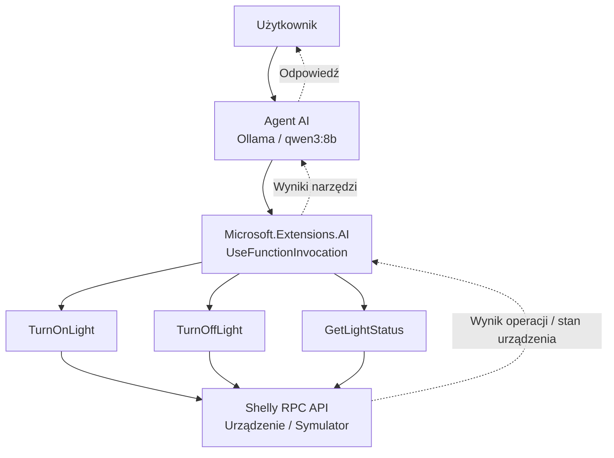

# 05 — Shelly Agent

## Cel

Aplikacja demonstruje **agenta AI, który samodzielnie dobiera działania w celu realizacji zadania użytkownika**.

W poprzednich przykładach poznaliśmy mechanizm Tool Calling oraz protokół MCP, umożliwiające modelowi korzystanie z zewnętrznych narzędzi.

W tym przykładzie wykorzystujemy te mechanizmy do realizacji zadań wymagających kilku kolejnych operacji.

Agent może obserwować stan urządzenia, podejmować decyzje, wykonywać działania i weryfikować ich rezultaty.

**Użytkownik określa cel, a agent decyduje, jak go osiągnąć.**

## Scenariusz

Użytkownik wydaje polecenie:

> Upewnij się, że lampka jest włączona.

Agent może:

1. Odczytać aktualny stan lampki.
2. Sprawdzić, czy lampka jest już włączona.
3. W razie potrzeby włączyć lampkę.
4. Ponownie odczytać jej stan.
5. Poinformować użytkownika o rezultacie.

Przykładowy przebieg:

```text
User: Upewnij się, że lampka jest włączona.

[TOOL] GetLightStatus
[TOOL RESULT] {"output":false,"apower":0,"voltage":230}

[TOOL] TurnOnLight

[TOOL] GetLightStatus
[TOOL RESULT] {"output":true,"apower":8.5,"voltage":230}

Assistant: Lampka została włączona.
Ponowny odczyt potwierdził jej stan.
```

Jeżeli lampka jest już włączona, agent może zakończyć zadanie bez wykonywania operacji zmieniającej stan urządzenia.

Model samodzielnie wybiera narzędzia i kolejność ich wywoływania. Przedstawiony przebieg jest przykładowy.

## Architektura



Agent korzysta z trzech narzędzi:

| Narzędzie | Odpowiedzialność |
|---|---|
| `TurnOnLight` | Włącza lampkę przez Shelly RPC API. |
| `TurnOffLight` | Wyłącza lampkę przez Shelly RPC API. |
| `GetLightStatus` | Odczytuje aktualny stan, moc i napięcie lampki. |

## Technologie

- .NET / C#
- Microsoft.Extensions.AI
- Ollama (`qwen3:8b`)
- Shelly RPC API

## Uruchomienie

Wymagane są uruchomione Ollama oraz dostęp do symulatora lub rzeczywistego urządzenia Shelly.

Pobierz model:

```bash
ollama pull qwen3:8b
```

### 1. Uruchom symulator Shelly

W pierwszym terminalu:

```bash
dotnet run --project 00-Shelly.Simulator
```

### 2. Uruchom agenta

W drugim terminalu:

```bash
dotnet run --project 05-Shelly.Agent -- http://localhost:8080
```

Możesz również wskazać adres rzeczywistego urządzenia:

```bash
dotnet run --project 05-Shelly.Agent -- http://172.20.10.2
```

## Działanie agenta

Aplikacja wykorzystuje `Microsoft.Extensions.AI` i mechanizm `UseFunctionInvocation()`:

```csharp
IChatClient chatClient = new ChatClientBuilder(client)
    .UseFunctionInvocation()
    .Build();
```

Mechanizm ten obsługuje wywołania narzędzi oraz przekazywanie ich wyników z powrotem do modelu.

Model może na tej podstawie zdecydować o kolejnych działaniach.

Przykładowy cykl działania agenta:

**Cel → Obserwacja → Decyzja → Działanie → Weryfikacja**

W kodzie aplikacji nie zapisano na stałe sekwencji wywołań narzędzi. Kolejność zależy od polecenia użytkownika, stanu urządzenia i decyzji modelu.

## Agent a Tool Calling

**Tool Calling** jest mechanizmem pozwalającym modelowi wywoływać funkcje przygotowane przez programistę.

**Agent AI** wykorzystuje dostępne mechanizmy do realizacji celu, podejmując kolejne decyzje na podstawie otrzymywanych informacji.

Oba przykłady korzystają z podobnych komponentów:

| `02-Shelly.ToolCalling` | `05-Shelly.Agent` |
|---|---|
| Demonstracja wywoływania funkcji | Demonstracja realizacji celu |
| Pojedyncze operacje na urządzeniu | Zadania wymagające kilku działań |
| Wybór odpowiedniego narzędzia | Wybór kolejnych działań na podstawie wyników |
| „Włącz lampkę” | „Upewnij się, że lampka jest włączona” |

Nie jest to jednak ścisła granica technologiczna. Aplikacja korzystająca z Tool Calling również może wykazywać zachowania agentowe.

Różnica dotyczy przede wszystkim sposobu wykorzystania narzędzi i zakresu samodzielności modelu.

## Ograniczenia

Agent może korzystać wyłącznie z udostępnionych mu narzędzi.

W obecnej wersji nie ma możliwości:

- wykonywania operacji z opóźnieniem,
- planowania działań na określoną godzinę,
- korzystania z innych urządzeń,
- wykonywania dowolnego kodu.

Model nie ma również gwarancji poprawnego wyboru narzędzi ani skutecznego zakończenia zadania.

W zastosowaniach produkcyjnych należałoby dodatkowo kontrolować uprawnienia, liczbę wywołań narzędzi, ponawianie operacji i warunki zakończenia.

## Podsumowanie

Aplikacja pokazuje, jak z wykorzystaniem LLM i Tool Calling zbudować prostego agenta działającego w rzeczywistym środowisku.

Agent nie musi ograniczać się do wykonania pojedynczego polecenia. Może obserwować stan urządzenia, podejmować kolejne decyzje i sprawdzać rezultaty swoich działań.

> **Chatbot odpowiada na pytania. Agent realizuje cele, podejmując działania na podstawie obserwacji środowiska.**