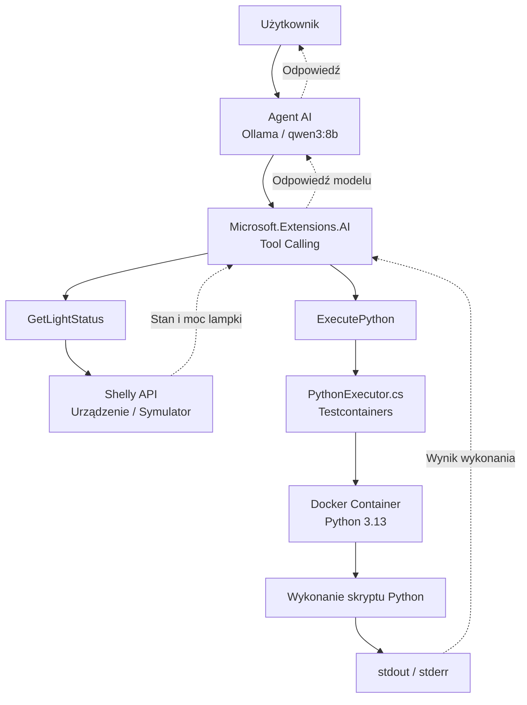

# 07 — Shelly Code Execution

## Cel

Aplikacja demonstruje **Code Execution** — mechanizm pozwalający agentowi AI generować i uruchamiać kod w celu realizacji zadania użytkownika.

W poprzednich przykładach model korzystał z funkcji przygotowanych przez programistę. Tutaj otrzymuje dodatkową możliwość: może samodzielnie wygenerować kod Pythona i wykonać go w kontenerze Docker.

**Model nie tylko wybiera narzędzie, ale również tworzy kod, który zostanie wykonany.**

## Scenariusz

Użytkownik pyta:

> Ile kosztuje świecenie mojej lampki przez 500 godzin przy cenie 4,50 zł/kWh?

Agent może:

1. Odczytać aktualną moc lampki z urządzenia Shelly.
2. Wygenerować kod Pythona obliczający zużycie energii i koszt.
3. Uruchomić kod w kontenerze Docker.
4. Odczytać wynik wykonania.
5. Przedstawić odpowiedź użytkownikowi.

Przykładowy przebieg:

```text
User: Ile kosztuje świecenie mojej lampki przez 500 godzin
      przy cenie 4,50 zł/kWh?

[TOOL] GetLightStatus
[TOOL RESULT] {"output":true,"apower":8.5,"voltage":230}

[TOOL] ExecutePython

Generated Python:
power_watts = 8.5
hours = 500
price_per_kwh = 4.50

energy_kwh = power_watts * hours / 1000
cost = energy_kwh * price_per_kwh

print(f"Zużycie: {energy_kwh:.2f} kWh")
print(f"Koszt: {cost:.3f} zł")

Execution result:
Zużycie: 4.25 kWh
Koszt: 19.125 zł

Assistant: Zużycie energii wynosi 4,25 kWh,
a koszt około 19,13 zł.
```

Model sam decyduje, czy i kiedy skorzystać z dostępnych narzędzi. Przedstawiona kolejność jest przykładowa.

## Architektura



Agent korzysta z dwóch narzędzi:

| Narzędzie | Odpowiedzialność |
|---|---|
| `GetLightStatus` | Odczytuje aktualny stan i moc lampki przez Shelly RPC API. |
| `ExecutePython` | Uruchamia wygenerowany kod Pythona w kontenerze Docker i zwraca wynik wykonania. |

## Technologie

- .NET / C#
- Microsoft.Extensions.AI
- Ollama (`qwen3:8b`)
- Testcontainers for .NET
- Docker
- Python 3.13

## Uruchomienie

Wymagane są uruchomione Ollama i Docker oraz pobrany model i obraz kontenera:

```bash
ollama pull qwen3:8b
docker pull python:3.13-slim
```

### 1. Uruchom symulator Shelly

W pierwszym terminalu:

```bash
dotnet run --project 00-Shelly.Simulator
```

Włącz lampkę:

```bash
curl -s "http://localhost:8080/rpc/Switch.Set?id=0&on=true"
```

### 2. Uruchom agenta

W drugim terminalu:

```bash
dotnet run --project 07-Shelly.CodeExecution -- http://localhost:8080
```

Możesz również wskazać adres rzeczywistego urządzenia Shelly.

### Wybór modelu i zdalne API

Domyślnie używany jest lokalny model `qwen3:8b` z Ollamy. Inny model wskażesz parametrem `--model`.

Zamiast Ollamy możesz użyć dowolnego API zgodnego z OpenAI Chat Completions (np. `https://llm.hpc.psnc.pl/v1`). Adres podaj parametrem `--endpoint`, a klucz API w zmiennej środowiskowej `LLM_API_KEY`:

```bash
export LLM_API_KEY=<YOUR_API_KEY>
dotnet run --project 07-Shelly.CodeExecution -- http://localhost:8080 --endpoint https://llm.hpc.psnc.pl/v1 --model DeepSeek-V3.1
```

PowerShell:

```powershell
$env:LLM_API_KEY="<YOUR_API_KEY>"
dotnet run --project 07-Shelly.CodeExecution -- http://localhost:8080 --endpoint https://llm.hpc.psnc.pl/v1 --model DeepSeek-V3.1
```

Serwer musi obsługiwać pole `tools`, aby działał Tool Calling.

## Code Execution

Za wykonywanie kodu odpowiada `PythonExecutor.cs`.

Przebieg:

1. Model generuje kod Pythona.
2. Narzędzie `ExecutePython` przekazuje kod do `PythonExecutor`.
3. Testcontainers uruchamia kontener.
4. Kod zostaje zapisany jako `/tmp/script.py`.
5. Python wykonuje skrypt.
6. Wynik (`stdout`) lub komunikat błędu (`stderr`) wraca do agenta.
7. Kontener zostaje usunięty.

W przypadku błędu model może przeanalizować komunikat i spróbować wygenerować poprawioną wersję kodu.

## Bezpieczeństwo

Kod generowany przez model należy traktować jako **niezaufany**.

W przykładzie zastosowano podstawowe ograniczenia kontenera:

- wyłączony dostęp do sieci,
- ograniczenie pamięci do 256 MB,
- ograniczenie zasobów CPU,
- usunięcie dodatkowych uprawnień systemowych,
- limit procesów,
- ograniczenie czasu wykonania.

Mechanizmy te ograniczają ryzyko, ale nie zapewniają pełnej izolacji przed złośliwym kodem.

**Jest to środowisko demonstracyjne, a nie produkcyjny sandbox.**

## Podsumowanie

**Tool Calling** pozwala modelowi korzystać z funkcji przygotowanych przez programistę.

**Code Execution** pozwala modelowi generować i wykonywać własny kod w udostępnionym środowisku.

W tej aplikacji oba mechanizmy współpracują: agent odczytuje dane z rzeczywistego lub symulowanego urządzenia, a następnie może wykorzystać Python do ich przetwarzania.

> Wygenerowanie kodu nie oznacza jego wykonania, a poprawne wykonanie nie gwarantuje poprawności wyniku.