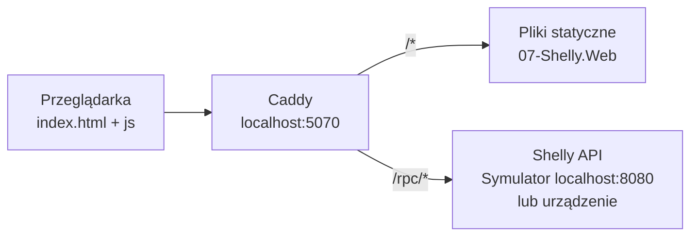

# 07 — Shelly Web

## Cel

Prosta strona WWW do sterowania lampką Shelly z przeglądarki — bez .NET, bez frameworków, tylko HTML, CSS i JavaScript.

Strona pozwala:

- włączyć i wyłączyć lampkę,
- odczytać jej stan,
- odczytać chwilowy pobór mocy.

## Architektura



Caddy pełni dwie role:

| Ścieżka | Obsługa |
|---|---|
| `/rpc/*` | Reverse proxy do Shelly (domyślnie symulator `localhost:8080`). |
| pozostałe | Serwowanie plików statycznych z bieżącego katalogu. |

Dzięki reverse proxy przeglądarka wysyła żądania do tego samego originu, z którego pobrała stronę, więc nie ma problemu z **CORS**.

## Struktura

| Plik | Odpowiedzialność |
|---|---|
| `index.html` | Interfejs użytkownika. |
| `css/site.css` | Style. |
| `js/shelly.js` | Wywołania Shelly RPC API (`Switch.GetStatus`, `Switch.Set`). |
| `js/app.js` | Obsługa przycisków i aktualizacja widoku. |
| `Caddyfile` | Konfiguracja serwera WWW i reverse proxy. |

## Uruchomienie

Wymagany jest serwer [Caddy](https://caddyserver.com/docs/install):

```bash
brew install caddy
```

### 1. Uruchom symulator Shelly

W pierwszym terminalu, z katalogu głównego `Shelly`:

```bash
dotnet run --project 00-Shelly.Simulator
```

### 2. Uruchom Caddy

W drugim terminalu, **z katalogu `07-Shelly.Web`** (Caddyfile serwuje pliki z bieżącego katalogu):

```bash
cd 07-Shelly.Web
caddy run
```

### 3. Otwórz stronę

```
http://localhost:5070
```

## Rzeczywiste urządzenie Shelly

Aby sterować fizycznym urządzeniem, zmień adres w `Caddyfile`:

```caddyfile
handle /rpc/* {
    reverse_proxy 192.168.1.50
}
```

gdzie `192.168.1.50` to adres IP urządzenia Shelly w sieci lokalnej, a następnie uruchom ponownie Caddy.
