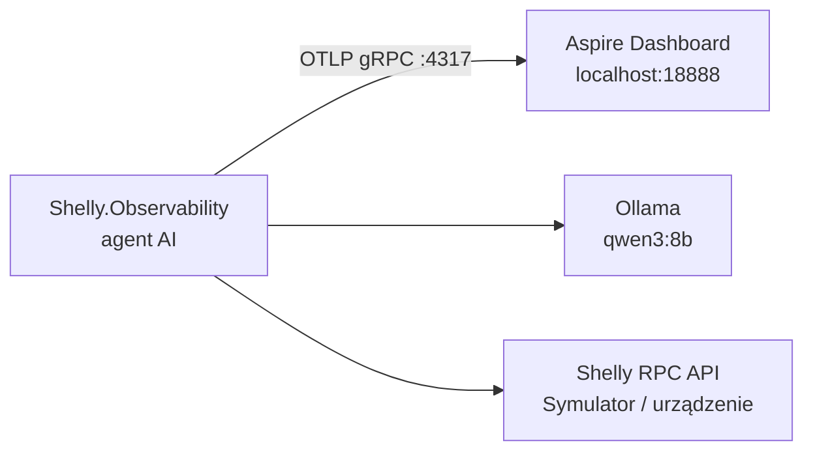

# 09 — Shelly Observability

## Cel

Aplikacja demonstruje **obserwowalność agenta AI** z wykorzystaniem **OpenTelemetry** i **Aspire Dashboard**.

W poprzednich przykładach działanie agenta widzieliśmy tylko w logach `[TOOL]` w konsoli. Nie było widać, ile razy aplikacja wywołała model, ile to trwało, ile tokenów zużyto ani gdzie agent czekał.

Tutaj agent z `06-Shelly.HumanInTheLoop` wysyła **ślady (traces)** i **metryki**, które oglądamy na osi czasu w przeglądarce.

**Nie da się kontrolować agenta, którego działania nie widać.**

## Co widać w śladzie

Jedno polecenie użytkownika daje jeden ślad. Przykład dla polecenia „Włącz lampkę.” z zatwierdzeniem:

```text
user_turn                                   (aplikacja)
├── orchestrate_tools                       (UseFunctionInvocation)
│   └── chat qwen3:8b                       (UseOpenTelemetry)
│       └── POST                            (HTTP do Ollamy: /api/chat)
├── user_approval                           (aplikacja: czekanie na decyzję człowieka)
└── orchestrate_tools
    ├── execute_tool turn_on_light          (wykonanie narzędzia)
    │   └── GET                             (HTTP do Shelly: /rpc/Switch.Set)
    └── chat qwen3:8b
        └── POST
```

| Span | Źródło | Co pokazuje |
|---|---|---|
| `user_turn` | aplikacja | Całe polecenie użytkownika wraz z odpowiedzią. |
| `orchestrate_tools` | `UseFunctionInvocation()` | Pętla Tool Calling: model → narzędzia → model. |
| `chat <model>` | `UseOpenTelemetry()` | Pojedyncze wywołanie modelu: prompt, odpowiedź, tokeny, czas. |
| `execute_tool <nazwa>` | `UseFunctionInvocation()` | Wykonanie narzędzia, jego argumenty i wynik. |
| `user_approval` | aplikacja | Czas oczekiwania na zgodę i decyzja (`approval.approved`). |
| `GET` / `POST` | `AddHttpClientInstrumentation()` | Żądania HTTP do Shelly i do Ollamy. |

Metryki:

| Metryka | Opis |
|---|---|
| `gen_ai.client.token.usage` | Liczba tokenów wejściowych i wyjściowych. |
| `gen_ai.client.operation.duration` | Czas wywołań modelu. |

Nazwy spanów i atrybutów (`gen_ai.*`) są zgodne z [OpenTelemetry Semantic Conventions for Generative AI](https://opentelemetry.io/docs/specs/semconv/gen-ai/), więc te same dane można oglądać w dowolnym narzędziu obsługującym OpenTelemetry.

## Architektura



## Jak to działa

### 1. Telemetria w potoku `IChatClient`

```csharp
IChatClient chatClient = new ChatClientBuilder(client)
    .UseFunctionInvocation()
    .UseOpenTelemetry(
        sourceName: ServiceName,
        configure: telemetry => telemetry.EnableSensitiveData = true)
    .Build();
```

Kolejność ma znaczenie. `UseFunctionInvocation()` jest na zewnątrz, a `UseOpenTelemetry()` bliżej modelu. Dzięki temu każde wywołanie modelu w pętli Tool Calling dostaje osobny span `chat`, a wykonanie narzędzi jest widoczne jako `execute_tool`.

`EnableSensitiveData = true` dodaje do śladów treść promptów, odpowiedzi oraz argumenty i wyniki narzędzi. Na zajęciach to bardzo przydatne, ale **w produkcji są to dane wrażliwe** i domyślnie nie powinny trafiać do telemetrii.

### 2. Eksport przez OTLP

```csharp
using var tracerProvider = Sdk.CreateTracerProviderBuilder()
    .SetResourceBuilder(resource)
    .AddSource(ServiceName)
    .AddHttpClientInstrumentation()
    .AddOtlpExporter()
    .Build();
```

Eksporter OTLP domyślnie wysyła dane na `http://localhost:4317`. Adres można zmienić zmienną środowiskową `OTEL_EXPORTER_OTLP_ENDPOINT`.

### 3. Własne spany aplikacji

Microsoft.Extensions.AI nie wie, co jest „poleceniem użytkownika” ani że aplikacja czeka na decyzję człowieka. Te fragmenty oznaczamy sami:

```csharp
using var turn = activitySource.StartActivity("user_turn");
turn?.SetTag("user.input", input);
```

```csharp
using var approval = activitySource.StartActivity("user_approval");
approval?.SetTag("gen_ai.tool.name", toolName);
```

## Uruchomienie

Wymagane są Docker, Ollama oraz symulator lub rzeczywiste urządzenie Shelly.

```bash
ollama pull qwen3:8b
```

### 1. Uruchom Aspire Dashboard

```bash
docker run --rm -it \
  -p 18888:18888 \
  -p 4317:18889 \
  -e ASPIRE_DASHBOARD_UNSECURED_ALLOW_ANONYMOUS=true \
  --name aspire-dashboard \
  mcr.microsoft.com/dotnet/aspire-dashboard:13.0
```

PowerShell:

```powershell
docker run --rm -it `
  -p 18888:18888 `
  -p 4317:18889 `
  -e ASPIRE_DASHBOARD_UNSECURED_ALLOW_ANONYMOUS=true `
  --name aspire-dashboard `
  mcr.microsoft.com/dotnet/aspire-dashboard:13.0
```

- `18888` — interfejs dashboardu: http://localhost:18888
- `4317` — odbiór telemetrii OTLP/gRPC (w kontenerze port `18889`)

`ASPIRE_DASHBOARD_UNSECURED_ALLOW_ANONYMOUS=true` wyłącza logowanie do dashboardu. To ustawienie wyłącznie do lokalnych demonstracji.

### 2. Uruchom symulator Shelly

```bash
dotnet run --project 00-Shelly.Simulator
```

### 3. Uruchom agenta

```bash
dotnet run --project 09-Shelly.Observability -- http://localhost:8080
```

Parametry `--model` i `--endpoint` działają tak samo jak w `05-Shelly.Agent`.

### 4. Obejrzyj ślady

Wydaj kilka poleceń, np.:

> Włącz lampkę.

> Jaki jest stan lampki?

Następnie otwórz http://localhost:18888:

- **Traces** — oś czasu każdego polecenia; kliknij span `chat`, aby zobaczyć prompt, odpowiedź i liczbę tokenów,
- **Metrics** — `gen_ai.client.token.usage` i `gen_ai.client.operation.duration`.

## Na co zwrócić uwagę

- **Gdzie płynie czas.** Zwykle prawie cały czas polecenia zajmują spany `chat`, a wywołanie Shelly trwa milisekundy. Przy zatwierdzaniu najdłuższy bywa `user_approval`.
- **Ile razy wywoływany jest model.** Polecenie „Włącz lampkę” to co najmniej dwa wywołania: wybór narzędzia i odpowiedź po jego wykonaniu.
- **Tokeny rosną z każdym poleceniem.** Cała historia rozmowy jest wysyłana do modelu za każdym razem.
- **Czy model naprawdę wywołał narzędzie.** Odpowiedź „Lampka została włączona” bez spanu `execute_tool turn_on_light` oznacza, że model to zmyślił.
- **Prompt injection.** Uruchom symulator z parametrem `--name` (zob. `06-Shelly.HumanInTheLoop`). W śladzie widać, który wynik narzędzia wprowadził złośliwą instrukcję do kontekstu.

## Co dalej?

Ślady mogą obejmować kilka procesów. Pakiet `ModelContextProtocol` emituje własne spany OpenTelemetry, więc po dodaniu telemetrii do `04-Shelly.McpClient` i `03-Shelly.Mcp` można prześledzić drogę polecenia od modelu przez serwer MCP aż do wywołania Shelly.

## Podsumowanie

> **Logi mówią, że coś się wydarzyło. Ślady pokazują, dlaczego, w jakiej kolejności i ile to kosztowało.**
