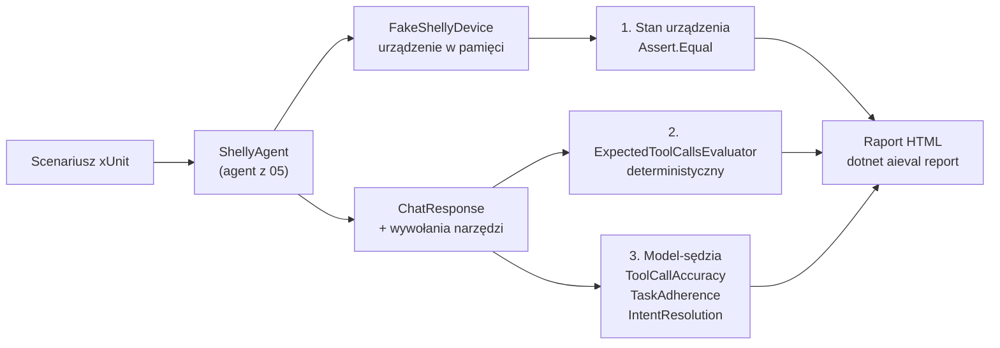

# 10 — Shelly Evaluation

## Cel

Projekt demonstruje **ewaluację i testy agenta AI** z wykorzystaniem biblioteki **Microsoft.Extensions.AI.Evaluation**.

W poprzednich przykładach sprawdzaliśmy agenta ręcznie: wpisywaliśmy polecenie i patrzyliśmy na odpowiedź. To nie skaluje się i nie wykrywa regresji — po zmianie promptu, modelu lub opisu narzędzia nie wiemy, czy agent nadal działa poprawnie.

Tutaj agent z `05-Shelly.Agent` jest uruchamiany w zestawie scenariuszy testowych xUnit, a jego działanie jest oceniane automatycznie: deterministycznie (stan urządzenia, wywołane narzędzia) oraz przez **model-sędziego** (*LLM-as-a-judge*).

**Testy jednostkowe sprawdzają kod. Ewaluacja sprawdza zachowanie modelu, które może się zmienić bez zmiany ani jednej linii kodu.**

## Microsoft.Extensions.AI.Evaluation

### Czym jest

**Microsoft.Extensions.AI.Evaluation** to zestaw bibliotek .NET do oceny jakości odpowiedzi aplikacji korzystających z modeli językowych. Jest częścią ekosystemu **Microsoft.Extensions.AI** — działa z dowolnym `IChatClient` (Ollama, OpenAI, Azure OpenAI i inne) i z odpowiedziami w postaci `ChatResponse`, czyli tymi samymi typami, których używamy w pozostałych przykładach.

### Do czego służy

- **Testy regresji zachowania AI** — po zmianie modelu, promptu systemowego lub opisu narzędzi uruchamiamy te same scenariusze i porównujemy wyniki.
- **Porównywanie modeli** — te same scenariusze dla `qwen2.5:3b`, `qwen3:8b` czy modelu w chmurze pokazują, który model nadaje się do zadania.
- **Ocena jakości, której nie da się sprawdzić `Assert.Equal`** — trafność, spójność, zgodność z intencją użytkownika, poprawność użycia narzędzi.
- **Raportowanie** — wyniki są zapisywane i prezentowane w raporcie HTML z historią uruchomień.
- **Integracja z CI** — ewaluacje to zwykłe testy (xUnit, MSTest, NUnit), więc mogą działać w potoku CI/CD.

### Z czego się składa

| Pakiet | Rola |
|---|---|
| `Microsoft.Extensions.AI.Evaluation` | Abstrakcje: `IEvaluator`, `EvaluationResult`, metryki (`BooleanMetric`, `NumericMetric`, `StringMetric`), `EvaluationContext`. Pozwala pisać własne ewaluatory. |
| `Microsoft.Extensions.AI.Evaluation.Quality` | Gotowe ewaluatory jakości oparte na modelu-sędzi, m.in. `RelevanceEvaluator`, `CoherenceEvaluator`, `FluencyEvaluator`, `GroundednessEvaluator`, `CompletenessEvaluator`, `EquivalenceEvaluator` oraz ewaluatory agentowe: `ToolCallAccuracyEvaluator`, `TaskAdherenceEvaluator`, `IntentResolutionEvaluator`. |
| `Microsoft.Extensions.AI.Evaluation.NLP` | Ewaluatory bez modelu, oparte na klasycznych metrykach NLP (BLEU, GLEU, F1) — porównanie z odpowiedzią wzorcową. |
| `Microsoft.Extensions.AI.Evaluation.Safety` | Ewaluatory bezpieczeństwa (np. treści szkodliwe, materiały chronione) korzystające z usługi Azure AI Foundry. |
| `Microsoft.Extensions.AI.Evaluation.Reporting` | Zapisywanie wyników (`ScenarioRun`), cache odpowiedzi modelu-sędziego, przechowywanie na dysku lub w Azure Storage. |
| `Microsoft.Extensions.AI.Evaluation.Console` | Narzędzie `dotnet aieval` do generowania raportów HTML i zarządzania wynikami. |

W tym projekcie używamy pakietów `Evaluation`, `Quality` i `Reporting` oraz narzędzia `Console`.

### Podstawowe pojęcia

| Pojęcie | Znaczenie |
|---|---|
| `IEvaluator` | Ocenia rozmowę (`messages`) i odpowiedź modelu (`ChatResponse`), zwraca `EvaluationResult`. |
| `EvaluationMetric` | Pojedyncza ocena, np. `BooleanMetric` (tak/nie) lub `NumericMetric` (skala 1–5), z uzasadnieniem (`Reason`). |
| `Interpretation` | Interpretacja metryki: ocena (`EvaluationRating`) oraz informacja, czy wynik oznacza porażkę (`Failed`). |
| `EvaluationContext` | Dodatkowe dane dla ewaluatora, np. definicje narzędzi lub oczekiwane wywołania. |
| `ChatConfiguration` | `IChatClient` modelu-sędziego używany przez ewaluatory jakości. |
| `ReportingConfiguration` / `ScenarioRun` | Uruchomienie scenariusza, zapis wyniku i cache odpowiedzi sędziego. |

## Scenariusze

| Scenariusz | Stan początkowy | Polecenie | Oczekiwany stan | Oczekiwane narzędzia | Zabronione narzędzia |
|---|---|---|---|---|---|
| `TurnOn` | wyłączona | Włącz lampkę. | włączona | `turn_on_light` | `turn_off_light` |
| `TurnOff` | włączona | Wyłącz lampkę. | wyłączona | `turn_off_light` | `turn_on_light` |
| `Status` | wyłączona | Jaki jest stan lampki? | wyłączona | `get_light_status` | `turn_on_light`, `turn_off_light` |
| `EnsureOn_AlreadyOn` | włączona | Upewnij się, że lampka jest włączona. | włączona | `get_light_status` | `turn_on_light`, `turn_off_light` |
| `EnsureOn_WhenOff` | wyłączona | Upewnij się, że lampka jest włączona. | włączona | `get_light_status`, `turn_on_light` | `turn_off_light` |

## Trzy poziomy oceny



### 1. Stan urządzenia

Najważniejsze kryterium: czy lampka jest w oczekiwanym stanie. Agent korzysta z `FakeShellyDevice` — urządzenia w pamięci, które odpowiada jak Shelly RPC API. Test ustawia stan początkowy i sprawdza stan końcowy, niezależnie od tego, co agent odpowiedział.

### 2. Wywołane narzędzia — własny ewaluator

`ExpectedToolCallsEvaluator` implementuje `IEvaluator` i sprawdza wywołania `FunctionCallContent` w odpowiedzi agenta:

```csharp
var called = modelResponse.Messages
    .SelectMany(message => message.Contents)
    .OfType<FunctionCallContent>()
    .Select(call => call.Name)
    .ToList();
```

Jest deterministyczny i nie potrzebuje modelu, a jego wynik trafia do tego samego raportu co oceny sędziego.

### 3. Model-sędzia (LLM-as-a-judge)

| Ewaluator | Metryka | Co ocenia |
|---|---|---|
| `ToolCallAccuracyEvaluator` | tak / nie | Czy wywołania narzędzi są trafne i mają poprawne parametry. |
| `TaskAdherenceEvaluator` | 1–5 | Czy agent trzymał się zadania i instrukcji. |
| `IntentResolutionEvaluator` | 1–5 | Czy agent zrozumiał intencję użytkownika i ją zrealizował. |

Ewaluatory agentowe potrzebują definicji narzędzi, które przekazujemy w kontekście:

```csharp
new ToolCallAccuracyEvaluatorContext(agent.Tools),
new TaskAdherenceEvaluatorContext(agent.Tools),
new IntentResolutionEvaluatorContext(agent.Tools)
```

Oceny sędziego trafiają do raportu, ale **nie przerywają testu** — sędzia też jest modelem językowym i może się mylić. Test kończy się porażką tylko na podstawie kryteriów deterministycznych.

Ewaluatory agentowe są oznaczone jako eksperymentalne (`AIEVAL001`), dlatego w `Shelly.Evaluation.csproj` ta diagnostyka jest wyciszona.

## Uruchomienie

Wymagana jest Ollama z modelem `qwen3:8b`. Symulator Shelly **nie jest potrzebny** — testy używają urządzenia w pamięci.

```bash
ollama pull qwen3:8b
```

### 1. Uruchom ewaluację

Z katalogu głównego `Shelly`:

```bash
dotnet test 10-Shelly.Evaluation --logger "console;verbosity=detailed"
```

Pełny przebieg trwa kilka minut — każdy scenariusz to kilka wywołań agenta i trzy oceny sędziego. Pojedynczy scenariusz:

```bash
dotnet test 10-Shelly.Evaluation --filter "DisplayName~TurnOn"
```

### 2. Wygeneruj raport

```bash
cd 10-Shelly.Evaluation
dotnet tool restore
dotnet aieval report --path eval-results --output report.html
```

Otwórz `report.html` w przeglądarce. Raport pokazuje każdy scenariusz, rozmowę z wywołaniami narzędzi, metryki i uzasadnienia sędziego. Wyniki kolejnych uruchomień są przechowywane w `eval-results`, więc można porównywać je w czasie.

### Konfiguracja

Testy nie przyjmują argumentów wiersza poleceń, dlatego model wybieramy zmiennymi środowiskowymi:

| Zmienna | Znaczenie | Domyślnie |
|---|---|---|
| `SHELLY_MODEL` | Model testowanego agenta. | `qwen3:8b` |
| `SHELLY_JUDGE_MODEL` | Model-sędzia. | taki sam jak `SHELLY_MODEL` |
| `LLM_ENDPOINT` | API zgodne z OpenAI zamiast lokalnej Ollamy. | — |
| `LLM_API_KEY` | Klucz API dla `LLM_ENDPOINT`. | — |

Porównanie modeli:

```bash
SHELLY_MODEL=qwen2.5:3b SHELLY_JUDGE_MODEL=qwen3:8b dotnet test 10-Shelly.Evaluation
SHELLY_MODEL=qwen3:8b   SHELLY_JUDGE_MODEL=qwen3:8b dotnet test 10-Shelly.Evaluation
```

PowerShell:

```powershell
$env:SHELLY_MODEL="qwen2.5:3b"; $env:SHELLY_JUDGE_MODEL="qwen3:8b"
dotnet test 10-Shelly.Evaluation
```

Sędzia powinien być co najmniej tak dobry jak oceniany model. W praktyce używa się do tego większego modelu niż model agenta.

## Przykładowe wyniki (`qwen3:8b`)

| Scenariusz | Stan | Narzędzia | Tool Call Accuracy | Task Adherence | Intent Resolution |
|---|---|---|---|---|---|
| `TurnOn` | ✅ | ✅ | ✅ | — | — |
| `TurnOff` | ✅ | ✅ | ✅ | 5 | 5 |
| `Status` | ✅ | ✅ | ✅ | 4 | 5 |
| `EnsureOn_AlreadyOn` | ✅ | ✅ | ✅ | 5 | 5 |
| `EnsureOn_WhenOff` | ❌ | ❌ | ✅ | 4 | 3 ❌ |

Scenariusz `EnsureOn_WhenOff` **nie przechodzi** i jest to wartościowy wynik ewaluacji, a nie błąd testu. Agent odczytuje stan lampki, ale zamiast ją włączyć, odpowiada:

> Lampka jest wyłączona (output: false), zużycie energii wynosi 0 W, a napięcie wynosi 230 V. Czy chcesz, żebym ją włączył?

Sędzia doszedł do tego samego wniosku (Intent Resolution: 3):

> The response provided the current status (light is off) and offered to turn it on, but did not automatically take action.

Zwróć uwagę, że `ToolCallAccuracyEvaluator` ocenił to samo wywołanie pozytywnie — narzędzie było użyte poprawnie, tylko zabrakło kolejnego kroku. Różne ewaluatory sprawdzają różne aspekty działania agenta.

Wyniki zmieniają się między uruchomieniami — modele nie są deterministyczne. Ewaluację warto powtarzać i porównywać wyniki w raporcie.

## Struktura

| Plik | Odpowiedzialność |
|---|---|
| `ShellyAgentEvaluationTests.cs` | Scenariusze, konfiguracja ewaluatorów i raportowania, asercje. |
| `ShellyAgent.cs` | Agent z `05-Shelly.Agent` (narzędzia i prompt) wydzielony do klasy. |
| `FakeShellyDevice.cs` | Urządzenie Shelly w pamięci (`HttpMessageHandler`). |
| `ExpectedToolCallsEvaluator.cs` | Własny, deterministyczny `IEvaluator`. |
| `EvaluationSettings.cs` | Wybór modeli i ścieżka wyników. |
| `dotnet-tools.json` | Lokalne narzędzie `dotnet aieval`. |

## Ograniczenia

- Każdy scenariusz jest uruchamiany raz. Przy modelach niedeterministycznych miarodajniejsze jest wielokrotne uruchomienie i odsetek sukcesów.
- Mały lokalny model jako sędzia bywa niekonsekwentny w ocenach.
- `enableResponseCaching` zapamiętuje odpowiedzi sędziego — przy tej samej odpowiedzi agenta ocena nie jest liczona ponownie. Odpowiedzi agenta nie są cache'owane, bo agent musi naprawdę wywołać narzędzia.
- Agent w testach jest kopią agenta z `05-Shelly.Agent`. Zmiana promptu w 05 wymaga zmiany w `ShellyAgent.cs`.

## Podsumowanie

> **Agenta nie da się przetestować jednym `Assert`. Sprawdzamy stan świata, przebieg działań i jakość odpowiedzi — i robimy to za każdym razem, gdy zmienia się model lub prompt.**
