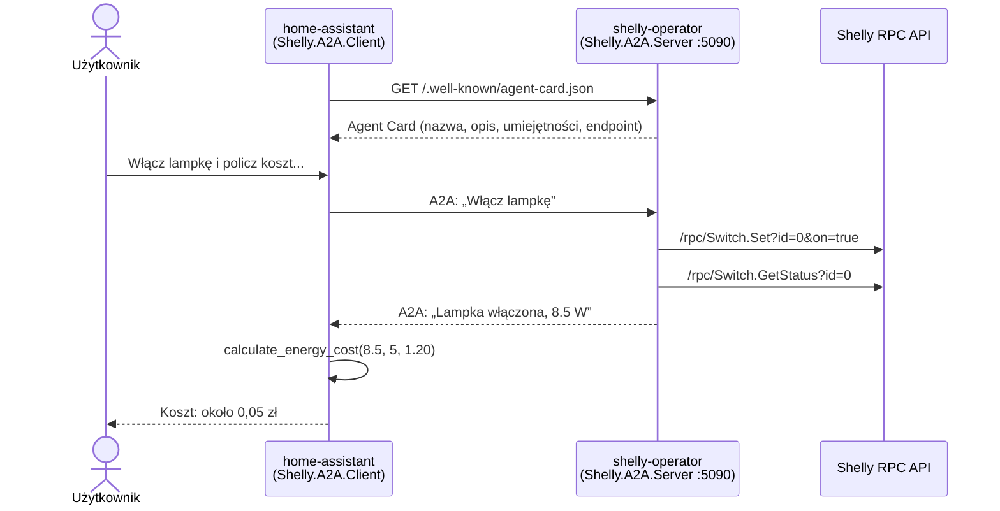

# 11 — Shelly A2A (Microsoft Agent Framework + Agent2Agent)

## Cel

Projekt demonstruje **współpracę agentów AI** z wykorzystaniem **Microsoft Agent Framework** oraz protokołu **A2A (Agent2Agent)**.

W poprzednich przykładach był jeden agent, który sam korzystał z narzędzi. Tutaj są dwa niezależne agenty, działające w osobnych procesach:

| Agent | Projekt | Rola |
|---|---|---|
| `shelly-operator` | `Shelly.A2A.Server` | Ma dostęp do lampki Shelly. Włącza ją, wyłącza i odczytuje stan. Udostępnia się innym agentom przez A2A. |
| `home-assistant` | `Shelly.A2A.Client` | Rozmawia z użytkownikiem. Nie ma dostępu do urządzenia — sterowanie lampką deleguje do `shelly-operator`, a koszty energii liczy sam. |

**MCP łączy agenta z narzędziami. A2A łączy agenta z innym agentem.**

## Scenariusz

```text
> Włącz lampkę i policz, ile będzie kosztować 5 godzin jej świecenia przy cenie 1,20 zł/kWh.

[A2A] -> shelly-operator: Włącz lampkę
[A2A] <- shelly-operator: Lampka włączona, pobór mocy: 8.5 W.
[TOOL] CalculateEnergyCost: 8,5 W × 5 h × 1,2/kWh = 0,05

Assistant: Lampka jest włączona, pobór mocy: 8,5 W.
5 godzin × 8,5 W = 42,5 Wh = 0,0425 kWh
0,0425 kWh × 1,20 zł/kWh = 0,051 zł
Koszt 5 godzin świecenia: około 0,05 zł.
```

W tym czasie w terminalu serwera:

```text
[TOOL] TurnOnLight
[TOOL] GetLightStatus
[TOOL RESULT] {"output":true,"apower":8.5,"voltage":230}
```

Koordynator nie wie, jak działa lampka ani jakie narzędzia ma `shelly-operator`. Wysyła polecenie w języku naturalnym i dostaje odpowiedź. Zdalny agent sam decyduje, których narzędzi użyć.

## Architektura



## Agent Card

### Czym jest Agent Card

**Agent Card** (wizytówka agenta) to dokument JSON, w którym agent opisuje się innym agentom. To podstawowy mechanizm **odkrywania agentów** w protokole A2A — odpowiednik dokumentacji API, ale przeznaczony dla maszyn.

Agent Card odpowiada na pytania, które klient musi zadać, zanim zacznie współpracę:

- **Kim jesteś?** — nazwa, opis, wersja.
- **Co potrafisz?** — lista umiejętności (*skills*) z opisami i przykładami poleceń.
- **Jak się z tobą komunikować?** — adres endpointu, protokół (HTTP+JSON, JSON-RPC, gRPC), obsługiwane formaty danych.
- **Jakie masz możliwości?** — np. strumieniowanie odpowiedzi, powiadomienia push.
- **Jak się uwierzytelnić?** — wymagane schematy bezpieczeństwa (np. OAuth 2.0, klucz API).

### Gdzie jest publikowana

Zgodnie ze specyfikacją A2A agent publikuje Agent Card pod dobrze znanym adresem (*Well-Known URI*):

```text
http://localhost:5090/.well-known/agent-card.json
```

Klient potrzebuje więc tylko **adresu bazowego** agenta — resztę odczytuje z wizytówki. Specyfikacja przewiduje też inne sposoby odkrywania: rejestry agentów (*Curated Registries*) oraz bezpośrednią konfigurację.

### Agent Card agenta `shelly-operator`

```bash
curl -s http://localhost:5090/.well-known/agent-card.json | jq
```

```json
{
  "name": "shelly-operator",
  "description": "Steruje lampką Shelly: włącza, wyłącza i odczytuje jej stan oraz pobór mocy.",
  "version": "1.0.0",
  "supportedInterfaces": [
    {
      "url": "http://localhost:5090/a2a",
      "protocolBinding": "HTTP+JSON",
      "protocolVersion": "1.0"
    }
  ],
  "capabilities": {
    "streaming": false
  },
  "skills": [
    {
      "id": "light-control",
      "name": "Sterowanie lampką",
      "description": "Włącza i wyłącza lampkę Shelly.",
      "tags": ["shelly", "light", "iot"],
      "examples": ["Włącz lampkę.", "Wyłącz lampkę."]
    },
    {
      "id": "light-status",
      "name": "Stan lampki",
      "description": "Odczytuje stan lampki Shelly i jej chwilowy pobór mocy w watach.",
      "tags": ["shelly", "power", "status"],
      "examples": ["Czy lampka jest włączona?", "Ile mocy pobiera lampka?"]
    }
  ],
  "defaultInputModes": ["text/plain"],
  "defaultOutputModes": ["text/plain"]
}
```

| Pole | Znaczenie |
|---|---|
| `name`, `description`, `version` | Tożsamość agenta. Opis trafia do modelu koordynatora, więc powinien jasno mówić, w czym agent pomaga. |
| `supportedInterfaces` | Gdzie i jakim protokołem wysyłać wiadomości. Agent może udostępniać kilka interfejsów, a klient wybiera preferowany. |
| `capabilities` | Funkcje protokołu obsługiwane przez agenta, np. `streaming`. |
| `skills` | Umiejętności agenta: co potrafi, z przykładami poleceń i tagami ułatwiającymi wyszukiwanie. |
| `defaultInputModes`, `defaultOutputModes` | Formaty danych (typy MIME), które agent przyjmuje i zwraca. |

### Agent Card a narzędzia MCP

Agent Card przypomina listę narzędzi serwera MCP (`tools/list`), ale opisuje coś innego:

| | Narzędzie MCP | Agent A2A |
|---|---|---|
| Opis | Schemat funkcji: nazwa, parametry JSON Schema | Agent Card: umiejętności opisane językiem naturalnym |
| Wywołanie | Konkretna funkcja z konkretnymi argumentami | Wiadomość w języku naturalnym |
| Kto decyduje, co zrobić | Model wywołujący narzędzie | Zdalny agent — ma własny model, instrukcje i narzędzia |
| Wynik | Wynik funkcji | Odpowiedź agenta (wiadomość lub zadanie) |

Agent Card mówi **co** agent potrafi, a nie **jak** to robi. Narzędzia `turn_on_light` czy `get_light_status` są wewnętrznym szczegółem `shelly-operator` i nie są widoczne dla koordynatora.

### Bezpieczeństwo Agent Card

Agent Card jest publiczna i niezaufana — tak jak wynik każdego narzędzia (zob. `06-Shelly.HumanInTheLoop`). Opis agenta trafia do kontekstu modelu koordynatora, więc złośliwy agent może w nim umieścić instrukcje (*prompt injection*). W zastosowaniach produkcyjnych warto korzystać tylko z zaufanych agentów, a Agent Card można podpisać (pole `signatures`).

## Microsoft Agent Framework

**Microsoft Agent Framework** to framework .NET (i Python) do budowania agentów AI i systemów wieloagentowych. Jest następcą Semantic Kernel i AutoGen i jest zbudowany na **Microsoft.Extensions.AI** — używa tych samych `IChatClient` i `AIFunction` co poprzednie przykłady.

### Agent jako obiekt

W poprzednich przykładach agenta tworzyliśmy ręcznie: `ChatClientBuilder`, `UseFunctionInvocation()`, lista `messages` i pętla. W Agent Framework agent jest obiektem `AIAgent`:

```csharp
AIAgent agent = client.AsAIAgent(
    name: "shelly-operator",
    description: "Steruje lampką Shelly...",
    instructions: "Jesteś agentem sterującym lampką Shelly...",
    tools: [ /* AIFunctionFactory.Create(...) */ ]);
```

Historię rozmowy przechowuje sesja (`AgentSession`), a obsługę Tool Calling framework zapewnia sam:

```csharp
var session = await agent.CreateSessionAsync();
var response = await agent.RunAsync("Włącz lampkę.", session);
```

### Agent lokalny i zdalny — ta sama abstrakcja

Najważniejsza cecha w tym przykładzie: **zdalny agent A2A też jest `AIAgent`**. Kod koordynatora nie rozróżnia, czy rozmawia z agentem w tym samym procesie, czy na innym serwerze:

```csharp
var resolver = new A2ACardResolver(new Uri("http://localhost:5090"));
var agentCard = await resolver.GetAgentCardAsync();

AIAgent shellyAgent = agentCard.AsAIAgent();

var response = await shellyAgent.RunAsync("Włącz lampkę", shellySession);
```

### Udostępnienie agenta przez A2A

Po stronie serwera wystarczy zarejestrować serwer A2A, zmapować endpoint i opublikować Agent Card:

```csharp
builder.AddA2AServer(agent);

var app = builder.Build();

app.MapA2AHttpJson(agent, "/a2a");
app.MapWellKnownAgentCard(agentCard);
```

### Agent jako narzędzie innego agenta

Koordynator korzysta ze zdalnego agenta jak z narzędzia. W tym przykładzie robimy to jawnie, aby widzieć komunikację w konsoli:

```csharp
AIFunctionFactory.Create(
    AskShellyAgent,
    name: "ask_shelly_agent",
    description: $"Sends a request to the remote agent '{agentCard.Name}': {agentCard.Description}")
```

Agent Framework ma też gotową metodę, która zamienia dowolnego agenta w narzędzie:

```csharp
AITool tool = shellyAgent.AsAIFunction();
```

## Uruchomienie

Wymagane są Ollama z modelem `qwen3:8b` oraz symulator lub rzeczywiste urządzenie Shelly.

```bash
ollama pull qwen3:8b
```

### 1. Uruchom symulator Shelly

```bash
dotnet run --project 00-Shelly.Simulator
```

### 2. Uruchom agenta `shelly-operator` (serwer A2A)

W drugim terminalu:

```bash
dotnet run --project 11-Shelly.A2A/Shelly.A2A.Server -- http://localhost:8080
```

Agent nasłuchuje pod adresem `http://localhost:5090`. Sprawdź jego Agent Card:

```bash
curl -s http://localhost:5090/.well-known/agent-card.json | jq
```

PowerShell:

```powershell
irm http://localhost:5090/.well-known/agent-card.json | ConvertTo-Json -Depth 5
```

### 3. Uruchom agenta `home-assistant` (klient A2A)

W trzecim terminalu:

```bash
dotnet run --project 11-Shelly.A2A/Shelly.A2A.Client
```

Opcjonalnie można podać adres innego agenta A2A:

```bash
dotnet run --project 11-Shelly.A2A/Shelly.A2A.Client -- http://localhost:5090
```

Przykładowe polecenia:

> Włącz lampkę i policz, ile będzie kosztować 5 godzin jej świecenia przy cenie 1,20 zł/kWh.

> Jaki jest stan lampki?

> Wyłącz ją.

Obserwuj oba terminale: klient pokazuje komunikację A2A (`[A2A] ->`, `[A2A] <-`), a serwer — wywołania narzędzi Shelly (`[TOOL]`).

### Wybór modelu i zdalne API

Obie aplikacje przyjmują parametry `--model` i `--endpoint` (klucz API w zmiennej `LLM_API_KEY`), tak jak `05-Shelly.Agent`. Każdy agent może korzystać z innego modelu:

```bash
dotnet run --project 11-Shelly.A2A/Shelly.A2A.Server -- http://localhost:8080 --model qwen2.5:3b
dotnet run --project 11-Shelly.A2A/Shelly.A2A.Client -- --model qwen3:8b
```

## Struktura

| Plik | Odpowiedzialność |
|---|---|
| `Shelly.A2A.Server/Program.cs` | Agent `shelly-operator` (Agent Framework), narzędzia Shelly, Agent Card, endpoint A2A. |
| `Shelly.A2A.Client/Program.cs` | Odkrywanie agenta przez Agent Card, agent `home-assistant` z narzędziami `ask_shelly_agent` i `calculate_energy_cost`. |

## Technologie

- Microsoft Agent Framework (`Microsoft.Agents.AI`)
- A2A (`Microsoft.Agents.AI.A2A`, `Microsoft.Agents.AI.Hosting.A2A.AspNetCore`) — **wersja preview**
- Microsoft.Extensions.AI
- Ollama (`qwen3:8b`)
- Shelly RPC API

Integracja A2A w Agent Framework jest w wersji preview, a API może się zmieniać. Nazwa `AgentSkill` występuje zarówno w `A2A`, jak i w `Microsoft.Agents.AI`, dlatego w serwerze używamy pełnej nazwy `A2A.AgentSkill`.

## Ograniczenia

- Serwer A2A nie wymaga uwierzytelnienia. W zastosowaniach produkcyjnych endpoint A2A należy zabezpieczyć i opisać w Agent Card (`securitySchemes`). Dokumentacja Agent Framework zwraca uwagę, że identyfikatory `contextId` i `taskId` z protokołu nie są tokenami autoryzacyjnymi.
- Serwer obsługuje jedną lampkę i jednego klienta — stan sesji jest przechowywany w pamięci.
- Klient ufa odpowiedziom zdalnego agenta. Odpowiedź „Lampka włączona” jest deklaracją innego modelu, a nie potwierdzeniem z urządzenia.
- Brak strumieniowania odpowiedzi (`streaming: false`).

## Podsumowanie

> **Agent Card mówi, co agent potrafi. A2A pozwala go o to poprosić. Agent Framework sprawia, że zdalny agent wygląda w kodzie tak samo jak lokalny.**
