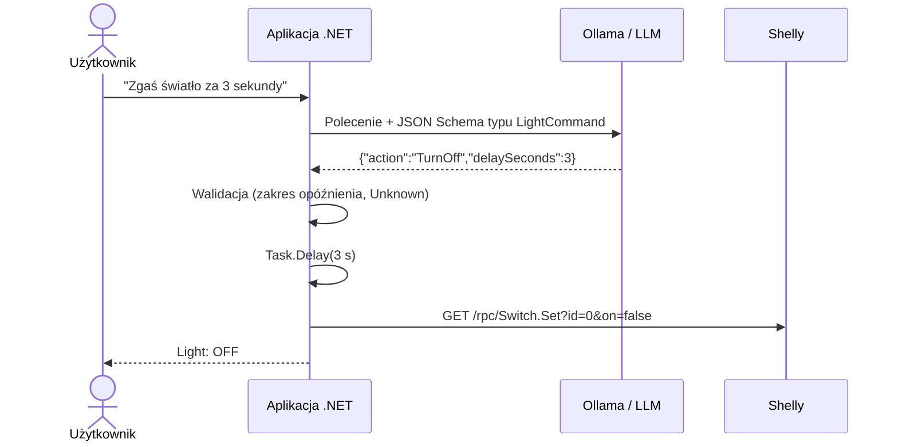

# 12 — Shelly Structured Output

Sterowanie lampką Shelly za pomocą języka naturalnego z wykorzystaniem **structured output**: model zamienia polecenie na obiekt C#, a aplikacja sama decyduje, co z nim zrobić.

## Cel

Projekt pokazuje drugi, obok Tool Calling, sposób, w jaki model językowy może sterować kodem.

W `02-Shelly.ToolCalling` model **wybiera funkcję**, a `UseFunctionInvocation()` od razu ją wykonuje. Tutaj model **niczego nie wywołuje**. Ma jedno zadanie: przetłumaczyć polecenie na obiekt o z góry ustalonej strukturze.

```text
"Zgaś światło za 3 sekundy"  →  model  →  {"action":"TurnOff","delaySeconds":3}  →  switch w C#
```

**Model rozumie polecenie, aplikacja je wykonuje.**

Miejsce w ścieżce rozwoju: między `01-Shelly.Http` (aplikacja wie, co zrobić) a `02-Shelly.ToolCalling` (model decyduje, którą funkcję wykonać). To pierwszy krok, w którym w aplikacji pojawia się LLM — ale bez żadnej autonomii.

## Przykładowa interakcja

```text
Connecting to Shelly at http://localhost:8080
Using model qwen3:8b
Enter a command (or 'exit' to quit):
> Zapal lampkę
[MODEL] {"action":"TurnOn","delaySeconds":0}
[APP] Turning light on...
[APP] Light: ON, power: 8.5 W
> Zgaś światło za 3 sekundy
[MODEL] {"action":"TurnOff","delaySeconds":3}
[APP] Czekam 3 s...
[APP] Turning light off...
[APP] Light: OFF, power: 0 W
> Ile prądu bierze lampka?
[MODEL] {"action":"Status","delaySeconds":0}
[APP] Light: OFF, power: 0 W
> Jaka jest stolica Francji?
[MODEL] {"action":"Unknown","delaySeconds":0}
[APP] Nie rozumiem polecenia. Mogę włączyć lub wyłączyć lampkę albo podać jej stan.
> Wyłącz lampkę za 5 godzin
[MODEL] {"action":"TurnOff","delaySeconds":18000}
[APP] Nieprawidłowe opóźnienie: 18000 s (dozwolone 0–3600 s).
```

Linia `[MODEL]` to wszystko, co zwraca model. Każda linia `[APP]` jest decyzją kodu aplikacji.

## Jak to działa



### 1. Typ wyniku

```csharp
[Description("Command for the Shelly light")]
public record LightCommand(
    [property: Description("Action requested by the user. Unknown if the request is not about the light or is unclear.")]
    LightAction Action,

    [property: Description("Delay before the action in seconds. 0 if the action should happen immediately.")]
    int DelaySeconds);

public enum LightAction { TurnOn, TurnOff, Status, Unknown }
```

Opisy z `[Description]` pełnią tę samą rolę co opisy narzędzi w Tool Calling — to z nich model wie, co oznacza każde pole.

### 2. Zapytanie o odpowiedź w formacie `LightCommand`

```csharp
var response = await client.GetResponseAsync<LightCommand>(
    [systemPrompt, new ChatMessage(ChatRole.User, input)]);

if (!response.TryGetResult(out var command))
{
    Console.WriteLine("[APP] Nie udało się odczytać odpowiedzi modelu.");
    continue;
}
```

Co dzieje się „pod spodem”:

1. `GetResponseAsync<T>()` generuje z typu `LightCommand` **JSON Schema**: pola, typy, dozwolone wartości enuma i opisy.
2. Schemat trafia do modelu jako wymagany format odpowiedzi (w Ollamie parametr `format`, w API zgodnym z OpenAI `response_format: json_schema`).
3. Serwer modelu ogranicza generowanie (*constrained decoding*), więc model praktycznie nie może zwrócić tekstu niezgodnego ze schematem.
4. MEAI deserializuje JSON do `LightCommand`. `TryGetResult` zwraca `false`, jeśli się nie udało; `Result` w takiej sytuacji rzuca wyjątek.

Enumy są w schemacie i w odpowiedzi zapisywane jako tekst (`"TurnOff"`), a nie liczby — tak działają domyślne ustawienia `AIJsonUtilities.DefaultOptions`. Modele dużo lepiej radzą sobie z nazwami niż z liczbami.

### 3. Walidacja

```csharp
if (command.DelaySeconds is < 0 or > MaxDelaySeconds) { ... }

if (command.Action == LightAction.Unknown) { ... }
```

**Schemat gwarantuje format, a nie sens.** `{"action":"TurnOff","delaySeconds":18000}` jest poprawnym JSON-em zgodnym ze schematem, ale aplikacja nie powinna czekać 5 godzin. Wynik modelu to niezaufane dane — ale w przeciwieństwie do Tool Calling łatwo je sprawdzić, *zanim* cokolwiek się wykona.

### 4. Wykonanie

```csharp
switch (command.Action)
{
    case LightAction.TurnOn:  await SetLight(true);  break;
    case LightAction.TurnOff: await SetLight(false); break;
    case LightAction.Status:  await ShowStatus();    break;
}
```

Zwykły kod C#. Model nie ma wpływu na to, co się stanie dla danej wartości `Action`.

## Structured output a Tool Calling

| | Structured output (12) | Tool Calling (02) |
|---|---|---|
| Co zwraca model | Dane (obiekt `LightCommand`) | Żądanie wywołania funkcji |
| Kto wykonuje działanie | Kod aplikacji (`switch`) | `UseFunctionInvocation()` |
| Kto decyduje o kolejności działań | Programista | Model |
| Liczba wywołań modelu | Jedno | Co najmniej dwa: wybór narzędzia i odpowiedź |
| Czy model widzi wynik działania | Nie | Tak — i może na niego zareagować |
| Walidacja przed wykonaniem | Naturalna — sprawdzamy obiekt | Trzeba ją wbudować w każde narzędzie |
| Przewidywalność | Wysoka | Niższa |
| Elastyczność | Tylko to, co przewiduje schemat | Model może łączyć narzędzia w nieprzewidziane sekwencje |
| Opóźnienie „za 3 sekundy” | Pole `delaySeconds` + `Task.Delay` | Wymaga osobnego narzędzia |

**Structured output: model rozumie, aplikacja działa. Tool Calling: model rozumie i działa.**

## Kiedy stosować

- **Zamknięty zbiór działań** — polecenia głosowe, formularze, klasyfikacja zgłoszeń.
- **Działania, które trzeba zwalidować** lub zatwierdzić przed wykonaniem.
- **Ekstrakcja danych** — z e-maila, faktury czy opisu wyciągamy rekord.
- **Małe modele** — structured output to jedno wywołanie, zwykle pewniejsze niż pętla Tool Calling.

## Eksperymenty

Spróbuj wydać polecenia:

* „Zapal lampkę”.
* „Zrób jasno”.
* „Zgaś światło za 3 sekundy”.
* „Włącz lampkę za pół minuty”.
* „Ile prądu bierze lampka?”.
* „Wyłącz lampkę za 5 godzin”.
* „Jaka jest stolica Francji?”.

Porównaj modele:

```bash
dotnet run --project 12-Shelly.StructuredOutput -- http://localhost:8080 --model qwen2.5:3b
dotnet run --project 12-Shelly.StructuredOutput -- http://localhost:8080 --model qwen3:8b
```

W naszych testach oba modele poprawnie rozpoznały akcje, ale „Włącz lampkę za pół minuty” `qwen2.5:3b` zamienił na `delaySeconds: 60`, a `qwen3:8b` na `30`. Odpowiedź była w obu przypadkach zgodna ze schematem — tylko jedna była poprawna.

### Rola promptu systemowego

JSON Schema zawiera **nazwy** wartości enuma (`TurnOn`, `TurnOff`, `Status`, `Unknown`), ale nie ich znaczenie. Bez opisu w prompcie `qwen2.5:3b` zwracał `Unknown` dla „Jaki jest stan lampki?” i „Zrób jasno”. Dlatego prompt systemowy wyjaśnia każdą akcję:

```text
- TurnOn: użytkownik chce włączyć lampkę lub mieć światło (np. „zapal”, „zrób jasno”).
- TurnOff: użytkownik chce wyłączyć lampkę lub nie mieć światła (np. „zgaś”, „zrób ciemno”).
- Status: użytkownik pyta o stan lampki lub jej pobór mocy.
- Unknown: polecenie nie dotyczy lampki albo jest niejasne.
```

Wartość `Unknown` jest równie ważna — bez niej model nie ma jak powiedzieć „nie wiem” i polecenie „Jaka jest stolica Francji?” zostałoby wciśnięte w jedną z akcji.

## Uruchomienie

Wymagana jest Ollama i symulator lub rzeczywiste urządzenie Shelly.

```bash
ollama pull qwen2.5:3b
```

```bash
dotnet run --project 00-Shelly.Simulator
```

W drugim terminalu:

```bash
dotnet run --project 12-Shelly.StructuredOutput -- http://localhost:8080
```

Domyślnie używany jest model `qwen2.5:3b`. Inny model wskażesz parametrem `--model`.

### Zdalny model przez API zgodne z OpenAI

```bash
export LLM_API_KEY=<YOUR_API_KEY>
dotnet run --project 12-Shelly.StructuredOutput -- http://localhost:8080 --endpoint https://llm.hpc.psnc.pl/v1 --model DeepSeek-V3.1
```

PowerShell:

```powershell
$env:LLM_API_KEY="<YOUR_API_KEY>"
dotnet run --project 12-Shelly.StructuredOutput -- http://localhost:8080 --endpoint https://llm.hpc.psnc.pl/v1 --model DeepSeek-V3.1
```

Serwer musi obsługiwać `response_format` z JSON Schema. Jeśli nie obsługuje, `GetResponseAsync<T>()` ma parametr `useJsonSchemaResponseFormat: false` — wtedy schemat trafia do promptu, ale zgodność odpowiedzi z formatem nie jest gwarantowana.

## Ograniczenia

- Jedno polecenie = jedna akcja. „Włącz lampkę i po minucie ją wyłącz” wymagałoby listy akcji w schemacie.
- Opóźnienie jest realizowane przez `Task.Delay` — w tym czasie aplikacja nie przyjmuje kolejnych poleceń.
- Model nie widzi wyniku działania, więc nie może zareagować np. na błąd urządzenia.

## Podsumowanie

> **Nie każda integracja z LLM musi oddawać modelowi kontrolę. Często wystarczy, że model zrozumie polecenie — a resztę zrobi zwykły kod.**
