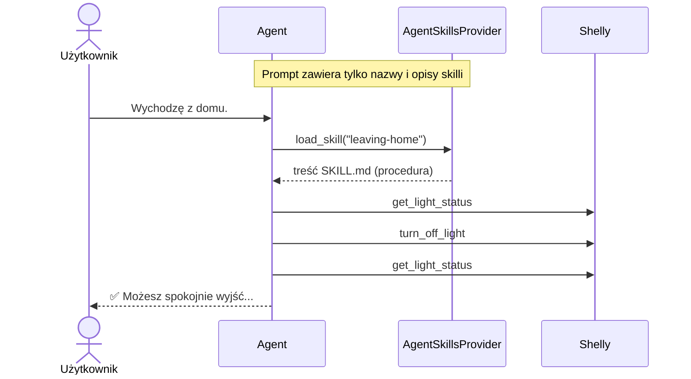

# 13 — Shelly Skills

## Cel

Projekt demonstruje **Agent Skills** — sposób przekazywania agentowi AI **wiedzy i procedur** w postaci plików, które agent ładuje dopiero wtedy, gdy są mu potrzebne.

Agent korzysta z tych samych narzędzi co w `05-Shelly.Agent` (`turn_on_light`, `turn_off_light`, `get_light_status`), ale dodatkowo ma dostęp do dwóch skilli:

| Skill | Co zawiera |
|---|---|
| `leaving-home` | Procedurę „wychodzę z domu”: sprawdź stan, wyłącz lampkę, potwierdź odczytem, odpowiedz w ustalonym formacie. |
| `energy-report` | Zasady liczenia zużycia i kosztu energii, format raportu oraz zasób `tariffs.md` z przykładowymi taryfami G11 i G12. |

Agent jest zbudowany w **Microsoft Agent Framework**, który obsługuje skille zgodne ze specyfikacją [Agent Skills](https://agentskills.io).

**Narzędzia mówią agentowi, co może zrobić. Skille mówią mu, jak to zrobić dobrze.**

## Czym jest skill

Skill to **katalog z plikiem `SKILL.md`**:

```text
skills/
├── leaving-home/
│   └── SKILL.md
└── energy-report/
    ├── SKILL.md
    └── tariffs.md        ← zasób (resource) skilla
```

`SKILL.md` składa się z nagłówka YAML (*frontmatter*) i instrukcji w Markdown:

```markdown
---
name: leaving-home
description: Procedura „wychodzę z domu” dla lampki Shelly. Użyj, gdy użytkownik wychodzi z domu,
  idzie spać, wyjeżdża albo prosi, żeby „wszystko wyłączyć”...
---

# Wychodzę z domu

## Kroki

1. Odczytaj aktualny stan lampki narzędziem `get_light_status`.
2. Jeśli lampka jest włączona (`output: true`), wyłącz ją narzędziem `turn_off_light`.
...
```

| Element | Rola |
|---|---|
| `name` | Identyfikator skilla (kebab-case, zgodny z nazwą katalogu). |
| `description` | **Kiedy** użyć skilla. Na tej podstawie model decyduje, czy go załadować. |
| Treść Markdown | Instrukcje: kroki, zasady, format odpowiedzi, przykłady. |
| Pliki obok `SKILL.md` | Zasoby (dane, dokumentacja) i opcjonalnie skrypty. |

Skill nie zawiera kodu, który trzeba kompilować. Może go napisać i zmienić osoba, która zna dziedzinę, a niekoniecznie programuje.

## Progressive disclosure — skill ładowany na żądanie

Skille nie trafiają w całości do promptu. `AgentSkillsProvider` realizuje trzy poziomy ujawniania (*progressive disclosure*):

| Poziom | Co trafia do modelu | Kiedy |
|---|---|---|
| 1. **Ogłoszenie** | Tylko `name` i `description` każdego skilla | Zawsze, w prompcie systemowym |
| 2. **Załadowanie** | Pełna treść `SKILL.md` | Gdy model wywoła `load_skill` |
| 3. **Zasoby** | Zawartość pliku, np. `tariffs.md` | Gdy model wywoła `read_skill_resource` |



Dzięki temu agent może mieć dostęp do dziesiątek skilli, a kontekst modelu rośnie tylko o te, których naprawdę używa.

## Przykładowe przebiegi

### Procedura: „Wychodzę z domu”

```text
> Wychodzę z domu.
[SKILL] load_skill {"skillName":"leaving-home"}
[TOOL] GetLightStatus
[TOOL RESULT] {"output":true,"apower":8.5,"voltage":230}
[TOOL] TurnOffLight
[TOOL] GetLightStatus
[TOOL RESULT] {"output":false,"apower":0,"voltage":230}

Assistant: ✅ Możesz spokojnie wyjść. Lampka jest wyłączona i nie pobiera prądu (0 W).
Lampka była włączona — wyłączyłem ją.
```

Słowo „lampka” ani „wyłącz” nie padło w poleceniu. Model dopasował je do opisu skilla `leaving-home`, załadował procedurę i wykonał ją krok po kroku — łącznie z ponownym odczytem stanu i komunikatem w formacie określonym w skillu.

### Wiedza dziedzinowa: raport energii

```text
> Ile miesięcznie kosztuje świecenie lampki codziennie od 18 do 23? Porównaj taryfy G11 i G12.
[TOOL] GetLightStatus
[TOOL RESULT] {"output":true,"apower":8.5,"voltage":230}
[SKILL] load_skill {"skillName":"energy-report"}
[SKILL] read_skill_resource {"skillName":"energy-report","resourceName":"tariffs.md"}

Assistant: **Raport energii — lampka Shelly**

| Parametr | Wartość |
|---|---|
| Moc | 8.5 W |
| Czas świecenia | 150 h (5 h/dzień × 30 dni) |
| Zużycie energii | 1.275 kWh |
| Taryfa / cena | G11: 1,20 zł/kWh • G12: 0,75 zł/kWh (noc), 1,45 zł/kWh (dzień) |
| **Koszt** | **1,53 zł (G11)** • **1,67 zł (G12)** |
...
**Tańsza taryfa:** G11 (1,53 zł vs. 1,67 zł).
```

Model nie znał taryf ani godzin stref — odczytał je z zasobu `tariffs.md` dopiero wtedy, gdy były potrzebne. Poprawnie podzielił godziny 18:00–23:00 na 4 h w strefie dziennej i 1 h w nocnej, a odpowiedź ma format opisany w skillu.

**Uwaga na obliczenia.** W tym przebiegu wynik końcowy był poprawny, ale w zapisie obliczeń model pomylił się (strefa nocna: 0,191 kWh zamiast 0,255 kWh, „zaokrąglenie” 1,622 → 1,67 zł). Modele językowe nie są niezawodnymi kalkulatorami. Specyfikacja Agent Skills przewiduje do tego **skrypty** — deterministyczny kod dołączony do skilla (zob. [Skrypty](#skrypty)).

## Do czego przydają się skille w kontekście Shelly

Narzędzia Shelly to tylko trzy proste operacje: włącz, wyłącz, odczytaj stan. To, co sprawia, że agent jest naprawdę użyteczny, to **wiedza, jak z nich korzystać** w konkretnych sytuacjach. Tę wiedzę dobrze jest trzymać w skillach.

### Procedury i scenariusze

Powtarzalne sekwencje działań z warunkami i weryfikacją:

- **„Wychodzę z domu”** — wyłącz, sprawdź, że pobór mocy wynosi 0 W, potwierdź (`leaving-home`).
- **„Tryb nocny”** — o 23:00 wyłącz lampkę, jeśli nikt nie ogląda telewizji.
- **„Symulacja obecności”** podczas urlopu — włączaj i wyłączaj lampkę wieczorem o różnych porach.
- **Procedura diagnostyczna** — gdy lampka nie świeci: sprawdź `output`, potem `apower`, potem napięcie, i dopiero wtedy zgłoś awarię.

### Wiedza dziedzinowa

Informacje, których model nie ma lub może mieć nieaktualne:

- **Taryfy energii** i godziny stref (`energy-report` + `tariffs.md`).
- **Interpretacja pomiarów** — co oznacza `apower` = 0 przy `output: true` (przepalona żarówka?), jaki pobór jest typowy dla LED, a jaki dla żarówki tradycyjnej.
- **Dokumentacja urządzenia** — opis API Shelly, limity, znaczenie pól, jako zasób skilla.

### Standardy odpowiedzi

Ustalony format raportów i komunikatów — np. raport energii zawsze jako tabela z pokazanymi obliczeniami, komunikat bezpieczeństwa zawsze z ikoną ✅ lub ⚠️. Dzięki temu odpowiedzi są spójne niezależnie od modelu.

### Zasady bezpieczeństwa

Reguły specyficzne dla scenariusza, np. „w procedurze `leaving-home` nigdy nie włączaj lampki” albo „nie włączaj lampki samodzielnie, żeby zmierzyć moc — zapytaj użytkownika”. Reguła dotyczy tylko sytuacji, w której skill jest używany, i nie zaśmieca ogólnego promptu.

### Rozwój bez zmiany kodu

Nową procedurę, np. „tryb kinowy”, dodaje się, tworząc katalog z plikiem `SKILL.md`. Nie trzeba zmieniać ani kompilować aplikacji. Skille można wersjonować w repozytorium i przeglądać w code review jak zwykłe dokumenty.

## Skills a Tool Calling

Skille **nie zastępują** Tool Calling — korzystają z niego. Odpowiadają na inne pytanie:

| | Tool Calling | Skills |
|---|---|---|
| Co dostarcza | **Możliwość** działania: funkcję, którą można wywołać | **Wiedzę**: jak i kiedy działać, w jakiej kolejności, z jakimi zasadami |
| Postać | Kod (funkcja C# + opis i schemat parametrów) | Dokument (Markdown + opcjonalne zasoby i skrypty) |
| Przykład w Shelly | `turn_off_light` | „Wychodzę z domu: sprawdź, wyłącz, zweryfikuj, potwierdź” |
| Kto tworzy | Programista | Programista lub ekspert dziedzinowy |
| Kiedy trafia do modelu | Definicje wszystkich narzędzi przy każdym wywołaniu | Tylko nazwa i opis; treść na żądanie |
| Koszt w kontekście | Rośnie z liczbą narzędzi | Niski — płacimy tylko za załadowane skille |
| Wpływ na świat | Bezpośredni (zmienia stan lampki) | Pośredni (kieruje użyciem narzędzi) |
| Zmiana | Zmiana kodu, kompilacja, wdrożenie | Edycja pliku |

Porównaj z `05-Shelly.Agent`: tam cała wiedza o tym, jak agent ma się zachowywać, była zapisana w jednym prompcie systemowym. Gdyby dopisać do niego procedurę „wychodzę z domu”, taryfy energii, procedurę diagnostyczną i tryb nocny, prompt rósłby z każdym scenariuszem — i trafiałby do modelu w całości przy każdym poleceniu, nawet „Włącz lampkę”.

Skille dzielą tę wiedzę na niezależne moduły ładowane tylko wtedy, gdy są potrzebne.

**Tool Calling to ręce agenta. Skille to jego instrukcje obsługi.**

### Skills, MCP i prompty MCP

| | Co udostępnia | Kto decyduje o użyciu |
|---|---|---|
| Narzędzie (Tool Calling / MCP tool) | Działanie | Model |
| Zasób MCP | Dane | Aplikacja (klient) |
| Prompt MCP | Gotowe polecenie | Użytkownik |
| **Skill** | **Instrukcje i wiedza + zasoby** | **Model** — na podstawie opisu skilla |

Skill przypomina prompt MCP (oba zawierają instrukcje), ale to **model** decyduje o jego załadowaniu, dopasowując zadanie do opisu. Prompt MCP wybiera użytkownik.

## Jak to działa w kodzie

### 1. Provider skilli

```csharp
var skillsProvider = new AgentSkillsProvider(
    skillsPath,
    null,
    null,
    new AgentSkillsProviderOptions
    {
        DisableLoadSkillApproval = true,
        DisableReadSkillResourceApproval = true,
        DisableRunSkillScriptApproval = true
    });
```

`AgentSkillsProvider` odkrywa wszystkie katalogi z `SKILL.md` w `skillsPath` i udostępnia modelowi narzędzia:

| Narzędzie | Działanie |
|---|---|
| `load_skill` | Zwraca pełną treść `SKILL.md`. |
| `read_skill_resource` | Zwraca zawartość zasobu skilla (np. `tariffs.md`). |
| `run_skill_script` | Uruchamia skrypt skilla (w tym projekcie nieużywane). |

**Domyślnie wszystkie trzy wymagają zatwierdzenia przez użytkownika** — treść skilla trafia do kontekstu modelu i wpływa na jego działanie, a skrypty wykonują kod. Ponieważ nasze skille są lokalne i zaufane, a nie zawierają skryptów, zatwierdzanie wyłączamy. Przy skillach z niezaufanych źródeł warto je zostawić (zob. `06-Shelly.HumanInTheLoop`).

### 2. Agent

```csharp
AIAgent agent = client.AsAIAgent(new ChatClientAgentOptions
{
    Name = "shelly-agent",
    ChatOptions = new ChatOptions
    {
        Instructions = "...",
        Tools = [ /* turn_on_light, turn_off_light, get_light_status */ ]
    },
    AIContextProviders = [skillsProvider]
});
```

`AIContextProviders` to mechanizm Agent Framework, który przed każdym wywołaniem modelu może dodać do kontekstu instrukcje i narzędzia. `AgentSkillsProvider` dodaje listę skilli i trzy narzędzia opisane wyżej.

### 3. Podgląd ładowania skilli

```csharp
.AsBuilder()
.Use(async (agent, context, next, cancellationToken) =>
{
    var name = context.Function.Name;

    if (name is AgentSkillsProvider.LoadSkillToolName or AgentSkillsProvider.ReadSkillResourceToolName)
        Console.WriteLine($"[SKILL] {name} {JsonSerializer.Serialize(context.Arguments)}");

    return await next(context, cancellationToken);
})
.Build();
```

Middleware wywołań funkcji w Agent Framework pozwala obserwować (lub blokować) każde wywołanie narzędzia — tu wypisujemy, kiedy model ładuje skill.

## Skrypty

Specyfikacja Agent Skills pozwala dołączyć do skilla **skrypty** (np. `.py`, `.sh`, `.cs`), które model uruchamia narzędziem `run_skill_script`. To dobre miejsce na obliczenia, których nie warto powierzać modelowi — np. `calculate_cost.py` dla skilla `energy-report`.

W tym projekcie skille nie zawierają skryptów, bo ich uruchomienie wymaga mechanizmu wykonywania kodu (`AgentFileSkillScriptRunner`) i — tak jak w `07-Shelly.CodeExecution` — odpowiedniej izolacji.

Ciekawostka z testów: przed dopisaniem do `energy-report` zdania „Ten skill nie zawiera skryptów — nie wywołuj `run_skill_script`” model `qwen3:8b` **wymyślił** skrypt `calculate-energy-cost` i próbował go uruchomić. To kolejny przykład, że model wypełnia luki własnymi założeniami — instrukcje w skillu powinny być jednoznaczne.

## Przenośność

Format `SKILL.md` jest otwartym standardem. Te same skille można użyć w innych środowiskach obsługujących Agent Skills, np. w Claude Code (katalog `.claude/skills/`).

Skill jest jednak przenośny tylko wtedy, gdy w nowym środowisku istnieją narzędzia, do których odwołują się jego instrukcje. Nasze skille odwołują się do `get_light_status`, a serwer `03-Shelly.Mcp` udostępnia stan lampki jako zasób `shelly://status`, a nie narzędzie — więc w Claude Code z tym serwerem procedura `leaving-home` wymagałaby dostosowania.

## Uruchomienie

Wymagane są Ollama z modelem `qwen3:8b` oraz symulator lub rzeczywiste urządzenie Shelly.

```bash
ollama pull qwen3:8b
```

### 1. Uruchom symulator Shelly

```bash
dotnet run --project 00-Shelly.Simulator
```

### 2. Uruchom agenta

```bash
dotnet run --project 13-Shelly.Skills -- http://localhost:8080
```

Parametry `--model` i `--endpoint` działają tak samo jak w `05-Shelly.Agent`.

Przykładowe polecenia:

> Wychodzę z domu.

> Ile miesięcznie kosztuje świecenie lampki codziennie od 18 do 23? Porównaj taryfy G11 i G12.

> Włącz lampkę.

Przy ostatnim poleceniu model zwykle nie ładuje żadnego skilla — proste zadanie nie pasuje do ich opisów.

### Dodaj własny skill

1. Utwórz katalog `13-Shelly.Skills/skills/<nazwa-skilla>/`.
2. Dodaj plik `SKILL.md` z polami `name` (taka sama jak nazwa katalogu) i `description`.
3. Uruchom agenta ponownie — skill zostanie odkryty automatycznie.

Pomysł na ćwiczenie: skill `diagnostics`, który na polecenie „Lampka nie świeci” sprawdza kolejno `output`, `apower` i `voltage` i na tej podstawie wskazuje prawdopodobną przyczynę.

## Struktura

| Plik | Odpowiedzialność |
|---|---|
| `Program.cs` | Agent (Agent Framework), narzędzia Shelly, `AgentSkillsProvider`, middleware podglądu. |
| `skills/leaving-home/SKILL.md` | Procedura „wychodzę z domu”. |
| `skills/energy-report/SKILL.md` | Zasady i format raportu energii. |
| `skills/energy-report/tariffs.md` | Zasób: przykładowe taryfy G11 i G12. |

## Ograniczenia

- Ceny w `tariffs.md` są przykładowe.
- Skille nie zawierają skryptów — obliczenia wykonuje model, który może się pomylić.
- Wybór skilla zależy od modelu i jakości pola `description`. Zbyt ogólny opis powoduje ładowanie skilla bez potrzeby, zbyt wąski — pomijanie go.

## Podsumowanie

> **Narzędzia dają agentowi możliwości. Skille dają mu wiedzę, jak z nich korzystać — modułowo, na żądanie i bez zmiany kodu.**
